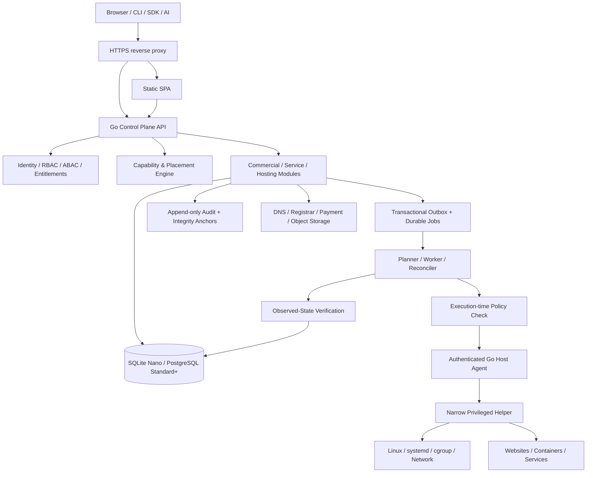

# NexusPanel — Master Product & Engineering Specification
## Volume 03 — System Architecture & Infrastructure

**Version:** 1.0 consolidated | **Status:** Proposed technical contract; review and verification required | **Date:** 2026-11-06  
**Authority:** Volume 01 (product requirements) and the authoritative 29-area scope. **Companion:** Volume 02 (UX); Volumes 04–10 define detailed contracts.  
**Sources consolidated:** Master Blueprint v2.0, Stages 2–7 v2.0, 29-area scope register v2.0 and the Volume 01–02 master drafts.  
**Operational boundary:** Design only. No commands have been executed against the Leaseweb VPS.

### Reading contract
This is a consolidated target architecture, **not** an inventory of deployed services or a claim that proposed performance figures have been demonstrated. **MUST** means a release-blocking design obligation for the applicable module; **SHOULD** means preferred with recorded exception; **VERIFY** marks a hypothesis requiring measurements; **DECISION** marks a material choice not yet approved. Volume 01 owns *what* must be delivered. This volume owns system boundaries, topologies, safety invariants and architectural acceptance. Later volumes own concrete schemas, protocol payloads and runbooks. The 29 platform areas remain in scope irrespective of release phase or hardware profile.

### Architecture in one paragraph
NexusPanel is a modular Go control plane with a static SPA, a durable desired-state operations engine, and a narrowly privileged Go host agent. It can operate locally on a small VPS or centrally across a provider fleet. A policy/capability engine authorizes requested changes; a reconciler turns authorized intent into idempotent typed host operations and verifies observed state. Control-plane metadata is isolated from tenant data. Services are provisioned through a signed capability-aware catalog and shared ServiceTemplate envelope where appropriate, with specialized lifecycle adapters for stateful systems. The system must be safe when connectivity, memory, storage, dependencies or host services fail.

## 1. Foundational invariants

1. **Four independent spines:** Commercial (accounts, plans, ledger, entitlements), Service (catalog, templates, service lifecycle), Execution (jobs, policy, agents, reconciliation), Surface (guided router, portfolio, expert tools). No spine may bypass another's authority.
2. **One governed authorization path:** UI, API, CLI, plugins, webhooks and AI use the same ownership, entitlement, capability and policy enforcement; an interface is never a security boundary.
3. **Desired versus observed:** database writes do not imply successful server changes. Every infrastructure mutation creates a durable operation with observable verification.
4. **Explicit ownership:** organization → membership → hosting account/project → resource, with provider/reseller delegation modeled as scoped relationships.
5. **Small-host honesty:** every service has prerequisite and resource metadata; unsupported capabilities are explained rather than offered as working.
6. **Isolation is layered:** container controls do not replace authentication, filesystem authorization, network isolation, quotas, image provenance or secrets management.
7. **No unrestricted root execution:** browser, LLM, customer, reseller and plugin cannot send arbitrary root shell commands to the agent.
8. **Fail closed on uncertainty:** ambiguous owner, missing capability, expired approval, invalid signature, unavailable policy authority or untrusted desired state blocks privileged changes.
9. **Control-plane and tenant-data separation:** customer databases, mailbox contents, site files and backup payloads do not become ordinary management metadata.
10. **Deployments are profiles, not forks:** Nano, Starter, Standard and Provider share logical API contracts and resource semantics; feature availability varies by measured capacity and topology.
11. **Versioned contracts:** API, operation envelope, templates, adapters, database migrations and agent protocols declare compatibility and rollback limits.
12. **Audit before completion:** privileged changes, policy decisions, approvals, payments and destructive actions emit correlated, protected audit events.

## 2. Logical component architecture

**Responsibility boundaries:** The SPA renders and gathers intent; the API authenticates, validates, authorizes and exposes resources; domain modules own business invariants; the durable worker plans and reconciles; the agent validates bound typed instructions and acts on the host; adapters understand each service's actual behavior. The agent cannot grant itself a commercial entitlement. A payment gateway cannot directly change Linux state. The LLM cannot issue an unreviewed privileged command.

**Deployable units (initial):** static assets served by a reverse proxy; Go API/worker in a modular monolith (worker may be same binary but separately supervised); Go agent with narrowly scoped privileged helper; metadata database; optional local monitoring and service modules. A single-server install is a topology of the same contracts, not a separate product.

## 3. Deployment topologies and trust boundaries

| Profile | Typical topology | Control-plane store | Host workloads | Principal tradeoff |
|---|---|---|---|---|
| Nano | Local Go control plane + agent + static UI **or** remote control plane with local agent | SQLite when local | Static websites and minimal host services | Resource ceiling and recovery complexity; **VERIFY** 512 MB feasibility |
| Starter | Co-located or externalized management | SQLite or PostgreSQL subject to measured budget | Selected web/app services | Shared memory and I/O contention |
| Standard | Co-located Go API, PostgreSQL, agent and optional Docker | PostgreSQL | Isolated apps, databases, caches | More complete stack but still bounded by physical capacity |
| Provider | Central control plane plus authenticated managed nodes | PostgreSQL with future HA | Workload and service-role nodes | Remote agent trust, placement, fleet consistency |

**Network boundaries:** public HTTPS edge; authenticated control-plane API; internal API-to-worker channel; local Unix-domain agent socket for the proposed v1 single-host design; future remote agent channel with mutually authenticated transport; container networks with explicit ingress/egress rules; third-party provider callbacks isolated at an integration boundary. Control-plane database must not be reachable from tenant networks. Do not expose the agent's privileged socket through a web proxy or container volume.

**Local agent authentication:** v1 proposes Unix socket filesystem permissions and `SO_PEERCRED` identity checks, **plus** per-operation authorization, binding and replay defenses. Socket peer identity alone does not replace policy or approval. Remote multi-node deployments require a separate threat review, enrollment, rotation and mTLS before enabling remote privileged operations. A provider feature may be architecturally represented before remote execution is released.

**Installer profiles:** topology must be selectable or automatically recommended; never silently move customer data to an external service. If the local panel is too expensive for Nano, a remote-control-plane configuration must be documented as an alternative, not mislabeled as an entirely self-hosted local deployment.

## 4. Hardware capability ladder and resource accounting

| Tier | Candidate hardware | Intended experience | Restrictions |
|---|---|---|---|
| Nano | 512 MB–1 GB RAM, fractional/1 vCPU, ~10 GB disk | Static sites, TLS, SFTP, lightweight monitoring, remote backup, capability guidance | No assumed local Docker, DB, mail server, Node build or heavyweight analytics |
| Starter | ~1–2 GB RAM, 1 vCPU, 10–25 GB disk | Small services subject to preflight and externalization | Capacity-sensitive runtime/database selection |
| Standard | ~4–8 GB RAM, 2–4 vCPU, 40–100 GB disk | More application, container and database options | Per-workload limits, service reservations and disk planning |
| Provider | Multiple servers and dedicated roles | Reseller/provider, fleet, scale and separated control/data plane | Explicit node enrollment, HA and placement policies |

**These are product targeting bands, not proven minimums.** CPU architecture, burst credits, swap, disk IOPS, kernel, cgroup availability, filesystem and provider virtualization change what is feasible. Fractional-vCPU compatibility must be measured under throttling. The installer shall detect physical capacity and headroom, not rely on provider marketing tier names.

### 4.1 Capability record
Each capability record MUST carry: stable ID and version; workload category; prerequisites and conflicts; supported OS/architecture/kernel/cgroup/runtime; minimum/floor, typical and ceiling budgets for memory, CPU, disk and I/O; data persistence needs; Docker eligibility; Nano eligibility; dependencies; required network ports; health probes; upgrade/rollback support; required backup policy; security privileges; implementation release phase; and reason codes when unavailable. A catalog entry is not proof of successful installation.

### 4.2 Placement and admission algorithm
1. Detect host CPU allocation and throttling signals, RAM, swap, free disk/inodes, I/O headroom, filesystem, OS/kernel, ports, cgroup delegation and existing services.
2. Verify service prerequisites, license/entitlement, requested ownership and policy; determine whether the capability is supported by the chosen topology.
3. Calculate **committed** hard memory/disk ceilings and **observed** current/typical/peak usage separately; preserve OS and panel survival headroom.
4. Check port, storage, dependency, security and incompatibility conflicts; distinguish a ceiling from a guarantee of reserved RAM or CPU.
5. Offer install, externalize, reduce footprint, queue for capacity, or refuse with exact reasons. Reserve admission budget atomically to prevent concurrent overcommit.
6. Re-evaluate when host capacity, workloads or template requirements change; never silently evict a tenant service.

**Allocation semantics:** `cpu.weight` enables relative CPU fairness; `cpu.max` is proposed for bounded batch jobs, not blanket serving caps; `memory.max` caps a workload; disk quotas and inode limits need filesystem-specific implementation. `cpuset` is not used in the initial allocation policy. This is a policy, not a guarantee that kernel CPU and memory controls alone deliver workload isolation or QoS. `memory.high`, `memory.oom.group`, `io.weight` and `pids.max` require design review and host compatibility tests. Set realistic limits for the control plane itself to avoid host-wide OOM.

**Required telemetry:** `current`, 7-day p50 `typical`, 24-hour p99 `peak`, configured `allocated`, and timestamp/data-quality indicators. Before seven days of history, return insufficient-data state rather than inventing percentiles.

## 5. Control-plane modules and domain ownership

| Bounded context | Owns | Does not own |
|---|---|---|
| Identity & tenancy | Users, memberships, grants, sessions, scoped delegation | Linux root identities |
| Commercial | Plans, subscriptions, invoices, payment ledger, entitlement projections | Payment provider truth without reconciliation |
| Inventory & capability | Nodes, resource availability, capability catalog, placement | User-facing payment policy |
| Hosting & domains | Sites, apps, domains, certificates, runtime intent | Arbitrary edits to unmanaged host configuration |
| Service catalog | Signed templates, dependencies, service instances, compatibility | Universal database/mail-specific recovery semantics |
| Operations | Durable jobs, outbox, steps, retries, reconciliation, drift | Business authorization decisions in isolation |
| Security & audit | Policy, approvals, keys, events, retention, integrity | Unreviewed LLM instructions |
| Monitoring & support | Measurements, alerts, diagnostics, incidents, tickets | Fabricated host success |
| Integration | DNS/registrar/payment/object-storage adapters and callback intake | Tenant root access |

Modules MUST communicate through typed internal interfaces and domain events, not cross-context writes that bypass invariants. Avoid early microservice fragmentation: use a modular Go monolith with explicit seams, transactional outbox and bounded workers. Scale/split only after evidence that the boundary is operationally justified.

**Public API:** versioned `/api/v1` resources, consistent error envelopes, scoped pagination, idempotency keys for mutations, operation IDs for async changes and resumable SSE for status where feasible. Detailed endpoint schema belongs to Volume 05. The SPA's `/` route uses a single documented persona × capability surface-resolution contract; the API returns authoritative permissions and capabilities, while the SPA selects the actual landing from versioned surface data. No ambiguous second independent router policy.

## 6. Durable operations and state convergence

**Lifecycle:** `requested → validated → authorized → [approval_required] → queued → dispatched → running → verifying → succeeded`, with explicit terminal/holding states `rejected`, `cancelled`, `failed`, `compensating`, `partially_recovered`, `needs_manual_intervention`. Retry eligibility is derived from the step contract, not guessed from HTTP status.

**Operation envelope minimum:** operation ID, idempotency key, actor/tenant/account/resource, desired-state generation and expected observed revision, policy/capability decision references, risk tier, approval ID if needed, adapter/typed operation, bounded parameters, time-to-live, execution target, trace ID and workload category. The agent rechecks ownership and permitted operation shape at execution time; stale revisions and expired approvals fail closed.

**Correctness requirements:**
- Transactionally persist desired-state intent, operation record, quota/admission reservation and outbox event; never rely on a synchronous request thread to complete host mutation.
- Claim work with a lease/heartbeat and fencing token; use at-least-once dispatch with idempotent step handlers, not an exactly-once illusion.
- Persist step checkpoints and pre-change snapshots for risky operations. Classify operations as reversible, compensatable or irreversible; never promise rollback where it is impossible.
- Verify actual service health and configuration before marking success; expose partial success honestly.
- Reconcile drift only for explicitly managed resources. Detect unmanaged resources and request adoption consent; never overwrite unknown configuration by default.
- Rate-limit retries with exponential backoff and dead-letter/manual review after bounded attempts.
- Keep payment operations separate from host provisioning until confirmed entitlement is recorded. A pending payment is not an active hosting plan.

**Example — website create:** validate domain ownership and target capacity → authorize and reserve → persist site desired state → enqueue → allocate tenant directory and runtime isolation → write staged proxy config → syntax-test → atomic activation → health probe → certificate issuance where possible → verify HTTP response and ownership → commit observed generation and release reservations. On failure, restore safe config and retain diagnostic evidence.

## 7. Agent and privileged execution model

**Process boundary:** the Go agent runs a minimally privileged supervisor and a narrowly privileged helper for allowlisted OS mutations. No general `exec as root` endpoint, no direct raw command passthrough, no arbitrary shell from AI or plugin. Each adapter declares its exact permitted operations, resource ownership checks, filesystem roots, arguments, capabilities, expected effects and rollback/verification rules.

**Agent safety gates:** authenticated peer → protocol compatibility → signed/bound operation validation → expiration/replay check → ownership and policy/capability verification → host resource preflight → resource lock → execute typed step → verify → journal/audit → report. Local journals must survive process restarts. If disconnected, the agent can finish an already valid bounded operation according to its policy but cannot accept untrusted new commands.

**System interfaces:** Linux users/groups and filesystem ACLs; systemd units; Nginx/Apache configuration; ACME clients; SFTP; runtime managers; Docker/Compose on eligible nodes; database-specific administrative APIs; DNS and mail adapters; nftables/firewall integration; cgroup v2; metrics collectors; backup and restore executors. Each interface is a typed adapter, not a common privileged shell wrapper.

**Remote agents:** not production-ready until enrollment, mutual authentication, key rotation/revocation, node identity binding, certificate expiry recovery, network partition handling and replay/fencing tests are complete. This remains a release gate, even if remote node entities already exist in the data model.

## 8. Workload execution, isolation and scheduling

**Serving:** websites, APIs, databases, queues and caches; optimize latency and predictable restart. **Batch:** builds, image transforms, migrations, backups and AI diagnostics; queued, concurrency-bounded and able to yield under contention. **Infrastructure:** reverse proxy, agent, DNS resolver/authoritative components, monitoring and panel core; protected survival budget.

**Docker where eligible:** rootless/user-namespace remapping evaluated per workload; digest-pinned signed images; no privileged containers, host PID/network, unsafe mounts, broad Linux capabilities or exposed Docker socket by default. Per-service networks, secrets, CPU/memory/pids limits, volume ownership and health checks are mandatory. Docker does not itself provide a complete multi-tenant security boundary; assess stronger sandboxing for hostile workloads.

**Nano fallback:** OS user per hosting account, isolated filesystem roots, explicit ownership and symlink traversal defenses, SFTP restrictions, static site serving, strict process/service controls. Do not pretend OS-user isolation is equivalent to container isolation. Multi-tenant untrusted code execution is not automatically available on Nano.

**Batch scheduling:** priority and concurrency limits, CPU quota where appropriate, memory limits, queue age visibility, starvation avoidance, cancelability, checkpoint/partial-output cleanup and resource-pressure backoff. An overloaded host should queue a build, not kill the reverse proxy to satisfy it.

## 9. ServiceTemplate and specialized service contracts

**Universal template envelope:** stable ID/version, publisher, signature/digest, service class, description, supported hardware, Docker eligibility, dependencies, ports, required secrets, volumes, health probes, startup recipe, update policy, backup/restore hook, monitoring contract, permissions and security policy. Instance records bind the template to a tenant, host, desired generation and actual deployment state.

**Critical boundary:** `ServiceTemplate` unifies discovery, admission, provisioning and common lifecycle visibility; it does **not** make all stateful services operationally interchangeable. Database adapters need transactional consistency and engine-aware backups; mail needs deliverability and mailbox integrity; object storage needs consistency and retention; DNS needs zone semantics; containers need image/volume safety. Where a service cannot be safely described as a signed container template (e.g., Nano Nginx, host firewall), use a typed native adapter behind the same capability catalog rather than forcing containerization.

**Template safety:** signed publisher trust, immutable image digests, SBOM/provenance where supported, vulnerability policy, explicit privilege manifest, template schema validation, review/approval for elevated permissions, dependency lock and compatibility matrix. Template publication is not permission to run arbitrary host scripts. New templates may be data additions only when they use existing reviewed adapter capabilities; introducing a new privileged operation requires an agent and security review.

## 10. Persistence, consistency and migration

**Control-plane metadata:** SQLite proposed for Nano and optionally Starter; PostgreSQL for Standard/Provider. Both implement a common logical repository contract and the same domain invariants, but **do not** assume one SQL migration file can automatically translate every dialect. Prefer portable migrations plus dialect-specific audited implementations, tested against both engines.

**SQLite rules:** WAL and bounded checkpoint behavior, busy timeout, single-writer contention tests, fsync/durability testing, backups via SQLite-safe mechanisms, and schema upgrade verification. **PostgreSQL rules:** role separation, migration locks, connection pooling, PITR/WAL retention, encrypted backup and restore drills. Never store tenant application data inside the control-plane metadata store.

**Cross-backend invariants:** UUID identifiers, UTC timestamps, integer money minor units and currency, versioned optimistic concurrency, foreign-key semantics, unique idempotency keys, tenant ownership, operation/outbox atomicity and immutable audit references. Validate differences in JSON, partial indexes, transaction isolation, `RETURNING`, advisory locks and notification features. Avoid silent functional differences between Nano and Standard.

**Migration path:** export a consistent metadata snapshot, quiesce writes or use a verified catch-up protocol, migrate and validate counts/checksums/foreign keys, rebind operation queues safely, preserve encryption keys and audit-chain continuity, cut over with rollback window, and explicitly test failure midway. SQLite→PostgreSQL conversion is a **planned tested workflow**, not automatic portability by declaration. Detailed logical entities belong to Volume 04.

## 11. Network, ingress, DNS and certificates

- Reverse proxy owns public ingress and routes only to authorized workloads. Config changes use staged files, syntax validation and atomic activation; rollback is bounded and verified.
- Domain ownership is verified before sensitive hosting actions. DNS modes are `external_manual`, `external_api` and `local_authoritative`; do not confuse DNS hosting with registrar ownership or reverse-DNS/PTR control.
- v1 DNS guidance is distinct from later authoritative DNS hosting. External provider changes are asynchronous and propagation may be delayed; the UI shows actual verification state.
- ACME HTTP-01 can be v1 where routable; wildcard DNS-01 requires supported provider/credentials and later release approval. Certificates, private keys, renewals and HSTS need explicit lifecycle policies.
- Firewall rules use preflight simulation, conflict checks, a recovery window and verified access preservation. Never lock out SSH without a tested out-of-band recovery path.
- Network policies must account for IPv4/IPv6, container bridges, port collisions, local loopback trust, metadata service access, SSRF prevention and egress control.

## 12. Websites, apps, databases, email and platform services

| Service family | Architectural contract | Release/host caveat |
|---|---|---|
| Static websites | Per-tenant roots, Nginx ingress, domain/TLS lifecycle, logs and quotas | Nano candidate; validate actual footprint |
| Dynamic apps | Versioned build/deploy pipeline, runtime image, health probe, rollback and secrets | Container-capable host; builds are batch |
| Git deployment | Scoped credentials, signed/verified sources where feasible, immutable build artifacts, branch/environment mapping | Build resource admission required |
| Databases | Engine-specific lifecycle, auth, persistent volumes, consistent backup, restore tests | Standard+ target; not assumed on Nano |
| Email | External SMTP integration initially; mailbox hosting and deliverability later | Mail delivery reputation and DNS are independent requirements |
| DNS | Guided external DNS initially; authoritative clustering later | Zone delegation and PTR ownership distinct |
| Backups | Encrypted offsite payloads, manifests, integrity verification, restore drills | Nano remote-only candidate; avoid local-disk exhaustion |
| Storage/CDN | Signed service templates, object/transform/delivery adapters, bandwidth and retention controls | May require remote object storage or external delivery |
| Self-hosted apps | Curated templates, data volumes, upgrades, backup/restore, isolation | Not all templates fit every host |
| Caching/queue/search | Resource budgets, data persistence choices, network isolation, monitoring | Optional and resource-sensitive |

**Provisioning order:** identity/ownership → entitlement/capability → storage and secrets → runtime/network → service health → DNS/TLS → monitoring/backup → observed-state verification. A service may be partially provisioned; do not report success before its required dependencies pass. Cross-service actions use sagas/compensation rather than imaginary global transactions.

## 13. Commercial, reseller and provider architecture

**Commercial spine:** product catalog → plan → subscription → invoice → payment intent → gateway callback/reconciliation → ledger posting → entitlement projection. Gateway-specific adapters (M-Pesa reference; Stripe later) must not leak into hosting modules. Every gateway callback is untrusted until verified using the provider's documented mechanism, and reconciled against provider-side transaction state. Do **not** assume all M-Pesa callbacks carry the same cryptographic signature format as Stripe; the security design must be gateway-specific.

**Asynchronous states:** `initiated → pending → confirmed | failed | expired | reversed`, with idempotent callback intake, deduplication, delayed/out-of-order handling, explicit refunds/reversals and ledger integrity. Do not activate an entitlement based on an unverified client redirect or pending payment. Financial accounting and tenant provisioning are separately recoverable workflows.

**Reseller/provider:** explicit delegated hierarchy, quotas and pricing scopes; white-label domains/themes without policy bypass; support impersonation with expiry/justification/audit; fleet placement and service-role affinity; suspension with reversible state and retention policy. A reseller's branding cannot confer provider root privileges.

## 14. AI, extensions and automation boundaries

AI may summarize metrics, propose diagnosis, explain failed operations and draft plans. It must not invent observed state, obtain hidden secrets, or bypass deterministic policy. v1 read-only diagnostics and proposed actions remain subject to explicit user confirmation and normal approval paths; autonomous execution is a later separately approved release. Treat logs, site files, tickets and retrieved content as untrusted prompt-injection surfaces.

Extensions use signed packages, declared capabilities, sandboxing, version compatibility, revocable grants and per-tenant scope. No extension gets the host agent socket, control-plane DB credentials or Docker socket by default. Webhooks are signed and replay-protected; inbound callbacks are validated against provider-specific protocols. Automation keys are scoped, revocable, auditable and rate-limited.

## 15. Observability, resilience and recovery

**Core signals:** node CPU/RAM/disk/inodes/I/O/network, cgroup utilization, per-service health, queue depth/age, operation latency and failures, agent connectivity, API errors, TLS renewal, backup integrity, billing reconciliation and security alerts. High-cardinality labels must be bounded; Nano uses minimal collection and retention.

**Data quality:** measured timestamps, stale-state markers, missing-sample handling, no fabricated p50/p99. Dashboard state distinguishes desired, applying, observed, degraded and unknown.

**Failure matrix:**

| Failure | Required behavior | Evidence |
|---|---|---|
| API restart | Persisted jobs resume safely; no duplicate destructive step | Restart/fencing test |
| Agent restart | Local journal resumes/compensates; peer authorization re-established | Crash injection |
| Disk almost full | Refuse writes/installations, retain SSH/API recovery, bound logs | 95–100% disk test |
| Memory pressure | Defer batch; protect proxy/agent; report OOM correctly | 512 MB/1 GB pressure test |
| SQLite locked/corrupt | Backoff, integrity checks, restore procedure, no silent data loss | Contention/restore test |
| PostgreSQL unavailable | Degrade reads/writes explicitly; no false success | Database outage test |
| Lost connectivity | Mark observed state stale; queue safe work only; no arbitrary offline action | Network partition test |
| DNS propagation | Show pending verification; retry within policy | External DNS test |
| ACME rate limit | Preserve current cert, notify and retry safely | CA simulation |
| Payment callback duplicate | Deduplicate and reconcile; no double entitlement | Replay test |
| Partial restore | Preserve source and manifest, report exact partial state | Restore fault injection |
| Compromised template | Revoke trust, stop new deployments, identify affected instances | Signature/revocation test |

**Backups:** separately encrypted control-plane metadata and tenant data, tested offsite restoration, retention/legal hold policy, encryption key recovery and integrity manifests. RPO/RTO are tier-specific **proposals** until measured. HA, distributed failover and geo-redundancy are not assumed to exist in v1.

## 16. Installation, updates and operating-system support

**Five-stage installer:** (1) inventory hardware/OS/kernel/network; (2) detect existing services and conflicts; (3) derive capability profile and present install choices; (4) preview changes, privileges, ports, disk and rollback/recovery; (5) execute signed versioned installer with post-install health verification. No destructive takeover of unmanaged websites, packages or firewall rules without explicit authorization.

**Host compatibility:** Ubuntu 26.04.1 is a development reference, not automatically a supported production platform. Each OS release, CPU architecture, cgroup implementation, Docker version and service package combination requires a tested support matrix. Unsupported systems fail safely with explanation; no `curl | sh` trust shortcut.

**Updates:** signed artifacts, staged rollout, compatibility checks for API/agent/schema/templates, backup/rollback readiness, atomic binary replacement where possible, health gates and abort/repair paths. A schema migration that is not backward compatible requires an explicit maintenance/cutover plan.

**Reference development node:** Leaseweb Ubuntu 26.04.1 LTS, 4 vCPU, ~6 GiB RAM, ~100 GB storage; this is an integration host, not a minimum specification. The design does not authorize installing anything on it.

## 17. Capacity targets and measurable validation plan

**Do not publish as achieved until tested.** Proposed acceptance benchmarks:

| Test | Measurement | Pass rule (to be signed off) |
|---|---|---|
| Nano 512 MB boot | Peak RSS/PSS, total resident memory, swap, OOM, API responsiveness | Core remains manageable with static site under representative load; no OOM |
| Nano 1 GB | Concurrent static sites, TLS renewal, SFTP, backup queue | Core remains responsive during resource pressure |
| Fractional CPU | API latency, host steal/throttle, build queue behavior | Graceful degradation and accurate explanation |
| 10 GB disk | Installer footprint, updates, logs, backups, free-space reserve | No unbounded disk growth or unrecoverable full-disk state |
| Standard 4–8 GB | App deploy, container DB, reverse proxy, monitoring | Isolation, quota and rollback validated |
| SQLite contention | Parallel create/update and job queue | Correct idempotency and no lost updates |
| Control-plane outage | Agent/worker recovery | No duplicate or unauthorized changes |
| Multi-tenant abuse | CPU, memory, I/O, PID and network exhaustion | Isolation and host survival under adversarial test |
| ServiceTemplate malicious recipe | Privilege escalation and unsafe mounts | Denied with audit and no host effect |
| Remote agent enrollment | Replay, revocation, expired keys, partition | Fail-closed security and recoverable operations |

**Methodology:** publish exact host specs, kernel, package versions, background load, test duration, percentile calculation, logs and failure traces. Compare cold start, steady state, peak operations and recovery. A 40 MB panel target is a hypothesis, not a product guarantee. Set final budgets only after benchmark evidence and review.

## 18. Cross-volume interface contracts

| Interface | This volume fixes | Authoritative detail |
|---|---|---|
| Product behavior | Scope, phases, acceptance constraints | Volume 01 |
| Screen and journey | Guided router, capability states, operation progress | Volume 02 |
| Data model | Ownership, persistence and portability invariants | Volume 04 |
| API and events | Idempotency, operation resources, auth, transport | Volume 05 |
| Agent/adapters | Typed execution, journal, service lifecycle | Volume 06 |
| Templates/services | Signed catalog and specialized service semantics | Volume 07 |
| Security | Threat model, credentials, audit, incident response | Volume 08 |
| Commercial | Ledger, gateway verification, reseller/provider | Volume 09 |
| QA/rollout | Benchmarks, release gates, migrations, operations | Volume 10 |

**Conflict rule:** when source drafts disagree, this consolidated volume records the proposed coherent design but does not silently claim sign-off. Product behavior conflicts go to Volume 01; security or implementation choices requiring owner approval remain marked below. Later volumes must not contradict these invariants without a versioned change record.

## 19. Architectural traceability — all 29 areas

The table identifies primary ownership; each area also inherits identity, capability, durable operation, audit, observability and security contracts. An architectural slot is **not** a claim of shipped functionality.

| # | Area | Primary architectural owner | Core execution pattern |
|---|---|---|---|
| 01 | Dashboard | Monitoring/Surface | Scoped control-plane service |
| 02 | Server management | Inventory/Agent | Governed API + typed adapter/worker |
| 03 | Websites | Hosting/Proxy | Governed API + typed adapter/worker |
| 04 | DNS | DNS Adapter | External integration + durable reconciliation |
| 05 | SSL/TLS | TLS Adapter | Governed API + typed adapter/worker |
| 06 | File manager | File Adapter | Governed API + typed adapter/worker |
| 07 | Application manager | Service/Deployment | Governed API + typed adapter/worker |
| 08 | Runtime manager | Runtime Adapter | Governed API + typed adapter/worker |
| 09 | Databases | Database Adapter | Governed API + typed adapter/worker |
| 10 | Email hosting | Mail Adapter | Governed API + typed adapter/worker |
| 11 | Git/deployments | Deployment/Build | Governed API + typed adapter/worker |
| 12 | Backups | Backup Adapter | Governed API + typed adapter/worker |
| 13 | Security | Security/Policy | Governed API + typed adapter/worker |
| 14 | Monitoring | Observability | Governed API + typed adapter/worker |
| 15 | Terminal/developer | Scoped Developer Tools | Governed API + typed adapter/worker |
| 16 | User/account management | Identity/Tenancy | Scoped control-plane service |
| 17 | AI assistant | AI/Policy | Scoped control-plane service |
| 18 | Automation/API | Operations/API | Governed API + typed adapter/worker |
| 19 | Panel administration | Installer/Updates | Governed API + typed adapter/worker |
| 20 | Extensions | Extension Sandbox | Governed API + typed adapter/worker |
| 21 | Commerce/resellers | Commercial/Delegation | External integration + durable reconciliation |
| 22 | Migration/staging | Migration Worker | Governed API + typed adapter/worker |
| 23 | Containers/orchestration | Container Adapter | Governed API + typed adapter/worker |
| 24 | Performance/caching | Cache/Proxy Adapter | Governed API + typed adapter/worker |
| 25 | Email security/deliverability | Mail Security | External integration + durable reconciliation |
| 26 | Analytics/site quality | Analytics | Governed API + typed adapter/worker |
| 27 | Audit/compliance/support | Audit/Support | Scoped control-plane service |
| 28 | Platform Services | Service Catalog/Storage | Governed API + typed adapter/worker |
| 29 | Self-hosted Templates | Template Catalog | Governed API + typed adapter/worker |

## 20. Architecture verification cases (ARCH-T)

| ID | Verification case | Required observable outcome |
|---|---|---|
| ARCH-T-001 | Start API/agent on 512 MB candidate | Stable resource profile, measured headroom, no unbounded growth |
| ARCH-T-002 | 1 GB host with static site and TLS renewal | Service stays available or degrades with clear state |
| ARCH-T-003 | Attempt unsupported app on Nano | Capability refusal with reason and resource delta |
| ARCH-T-004 | Two tenants request same port | Deterministic conflict, no cross-tenant takeover |
| ARCH-T-005 | Duplicate idempotency key | One logical operation and no duplicated side effect |
| ARCH-T-006 | Crash after config write before verification | Journal recovery and accurate observed state |
| ARCH-T-007 | Agent socket access from unauthorized user | Denied and audited |
| ARCH-T-008 | Expired signed operation replay | Denied with no host mutation |
| ARCH-T-009 | Tenant reads another tenant's resource | Denied at API and data layer |
| ARCH-T-010 | Untrusted container requests host Docker socket | Denied before deployment |
| ARCH-T-011 | ServiceTemplate requires unknown root operation | Template rejected pending agent review |
| ARCH-T-012 | SQLite concurrent operations | No lost update, unique idempotency preserved |
| ARCH-T-013 | SQLite→PostgreSQL migration interruption | Consistent rollback/restart and audit continuity |
| ARCH-T-014 | Payment callback duplicate/out-of-order | Ledger and entitlement remain correct |
| ARCH-T-015 | External DNS slow propagation | Pending state, bounded retry, no false success |
| ARCH-T-016 | ACME challenge failure | Existing cert preserved; actionable alert |
| ARCH-T-017 | Host disk exhausted during backup | Safe failure and recovery path |
| ARCH-T-018 | Batch job during serving CPU pressure | Batch yields, serving health preserved |
| ARCH-T-019 | Remote agent revoked mid-operation | Bounded safe completion/abort per operation contract |
| ARCH-T-020 | AI prompt injection in site logs | No privileged tool bypass or secret disclosure |
| ARCH-T-021 | Malicious extension package | Signature/permission rejection |
| ARCH-T-022 | Unsupported Ubuntu/service version | Clear refusal or supported safe alternative |
| ARCH-T-023 | Managed config changed outside panel | Drift reported; no blind overwrite |
| ARCH-T-024 | Rollback impossible after destructive action | Explicit irreversible warning and recovery policy |
| ARCH-T-025 | Provider delegates reseller scope | Reseller cannot exceed upstream grant or quotas |
| ARCH-T-026 | SPA and API version mismatch | Safe compatibility message, no unsafe mutations |
| ARCH-T-027 | Node disconnected while jobs pending | Stale state and safe bounded queue behavior |
| ARCH-T-028 | Audit event integrity tampering | Detection with alert and external anchor verification |
| ARCH-T-029 | Restore from encrypted offsite backup | Verified content and ownership/secret restoration |
| ARCH-T-030 | Install on fractional vCPU | Throttling measured; no misleading performance promise |

## 21. Architecture decision and validation register

**Proposed defaults carried from v2.0 deliberations (not automatically signed off):**

| ID | Proposed decision | Validation/approval needed |
|---|---|---|
| ARC-DEC-001 | Go modular monolith control plane + Go agent | Benchmark binary memory, ops and maintainability |
| ARC-DEC-002 | Static SPA instead of SSR panel | Auth, caching, accessibility and router consistency tests |
| ARC-DEC-003 | SQLite Nano / PostgreSQL Standard+ | Dual-engine conformance and migration proof |
| ARC-DEC-004 | Unix socket + peer credentials for local v1 agent | Threat model, permissions and replay tests |
| ARC-DEC-005 | mTLS remote agent in later release | Enrollment, rotation and revocation design |
| ARC-DEC-006 | cgroup v2 cpu.weight / memory.max, batch cpu.max | Kernel and resource-pressure benchmarks |
| ARC-DEC-007 | Docker preferred on capable hosts | Isolation, user namespaces, disk and network policy tests |
| ARC-DEC-008 | Nano static sites via OS-user fallback | Multi-tenant risk assessment; restrict untrusted code |
| ARC-DEC-009 | ServiceTemplate shared envelope, specialized adapters | DB/mail/storage lifecycle conformance |
| ARC-DEC-010 | Guided persona × capability landing | Single router contract and usability tests |
| ARC-DEC-011 | M-Pesa async-first reference payment | Provider-specific callback verification and reconciliation |
| ARC-DEC-012 | AI v1 read-only/propose, no autonomous execution | Injection, policy and approval tests |
| ARC-DEC-013 | Signed templates/images, typed privileged operations | Supply chain and rollback verification |
| ARC-DEC-014 | Complete 29-area architecture, phased shipping | Phase-by-phase dependency and release gates |

**Unresolved questions that must not be silently treated as agreements:** precise minimum supported RAM and panel footprint; exact supported Linux distributions/kernel versions; Nano local versus remote-control-plane support policy; default memory survival reserve and batch quotas; SQLite backup/restore and migration tooling; remote-agent v1 versus v2 product commitments; image/template trust authorities; support for hostile multi-tenant workloads; exact SLO/RPO/RTO and retention tiers; service-specific update/rollback promises; M-Pesa integration details; commercial licensing policy. The user must approve consequential choices before implementation and marketing claims.

## 22. Definition of architecture readiness

A release or implementation phase is **not** architecture-ready until it has: (1) approved requirement IDs and phase; (2) component owner and trust boundary; (3) typed API and agent contracts; (4) data/tenant ownership and migration plan; (5) resource floor and verified capability gating; (6) security threat model and key/secret handling; (7) idempotency and recovery semantics; (8) monitoring and audit events; (9) tests including failure injection; (10) measured deployment profile; (11) rollback or explicit irreversibility policy; and (12) cross-volume traceability.

**No implementation authorization:** This document is an engineering specification draft. It neither certifies production readiness nor authorizes changes to the Leaseweb server.

