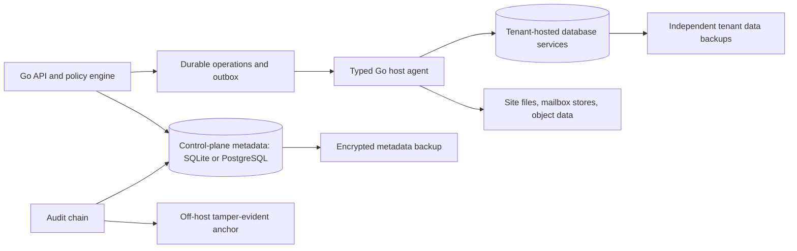
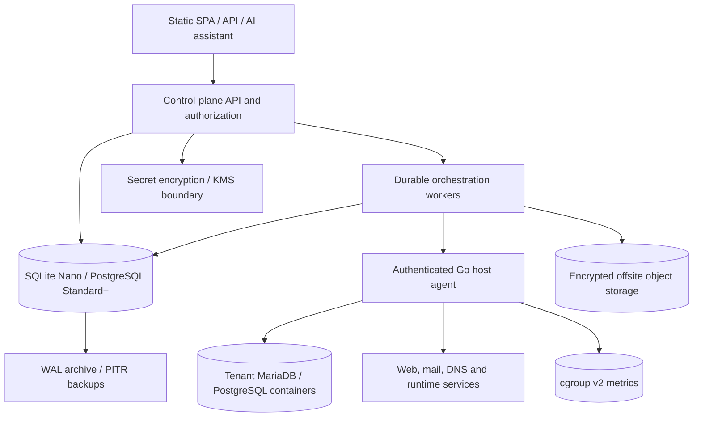
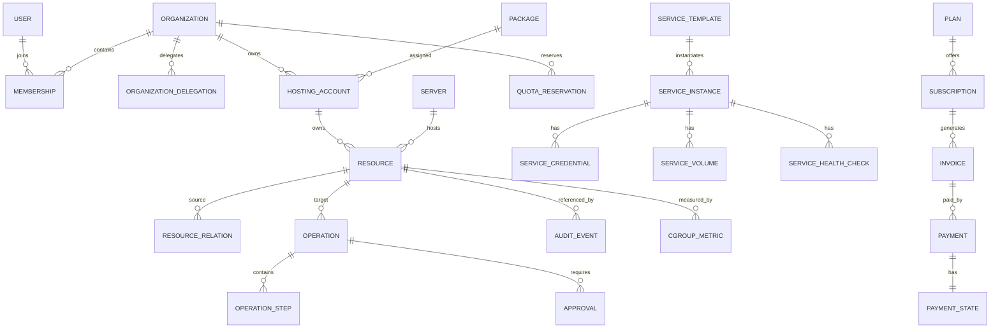

# NexusPanel — Master Product & Engineering Specification
## Volume 04 — Complete Database & Data Architecture

**Version:** 1.0 consolidated | **Status:** Proposed implementation contract; review required | **Date:** 2026-11-06  
**Authority:** Volume 01 (Master PRD), Volume 03 (System Architecture), authoritative 29-area scope.  
**Source material:** Uploaded Stage 5 Data Architecture v2.0, Master Blueprint v2.0, Stages 2, 4, 6 and 7 v2.0, and completed master volumes 01–03.  
**Operational boundary:** Specification only. No VPS changes or database migrations have been executed.

### Contract and interpretation

This volume consolidates the logical model, entity catalog, tenancy rules, lifecycle semantics, persistence portability, security, performance, migrations, backups, and verification obligations. It is not executable DDL. Normative **MUST** means required before the relevant module can be released; **SHOULD** is preferred with documented exceptions; **VERIFY** marks an unproven technical claim; **DECISION** marks a choice requiring explicit approval. Requirements in Volume 01 remain authoritative.

**Consolidated decisions and boundaries:**

1. **One control-plane database per deployment, two supported engines.** Nano uses SQLite; Standard/Provider uses PostgreSQL. Starter selection is capability-dependent. Tenant-hosted databases are always separate data-plane services.
2. **One logical domain model, not SQL feature parity by assertion.** Dialect-specific migrations, transaction semantics, lock behavior, indexing, JSON handling and restore must be verified independently. PostgreSQL RLS is defense in depth only on PostgreSQL; SQLite must rely on application-level scoping and process isolation.
3. **Shared ServiceTemplate envelope, specialized lifecycle.** A template describes deployable services, but databases, mail, storage, DNS and other stateful systems retain typed resources, backup/restore requirements, and explicit safety constraints. A signed catalog entry is not arbitrary executable permission.
4. **Capability and persona data are separate from permissions.** Capabilities describe feasible deployment; permission and entitlement policies decide who may act. UI persona controls navigation only.
5. **Cgroup paths are runtime observations, not immutable primary keys.** Stable resource IDs map to agent-observed cgroup identifiers; Nano static sites may share infrastructure cgroups. An unmounted or replaced cgroup is not an invalid database resource.
6. **Resource allocations are ceilings, not reserved consumption.** Quota reservations cover finite resources and concurrency; CPU weight and memory limits are enforced separately from measured usage.
7. **External payments are not trusted solely because a callback arrived.** Verify using provider-supported mechanisms, deduplicate, query/reconcile authoritative provider status when needed, and post financial ledger transitions idempotently.
8. **Nano resource budgets govern retention and background work.** Raw telemetry and audit off-host export must have bounded storage, batching and degradation rules; the proposed 512 MB target remains a benchmark gate.
9. **Migrations are reversible only where proven.** Destructive changes require snapshot, restore path, compatibility window, and forward-recovery procedures; no universal automatic downgrade guarantee.
10. **All 29 platform areas remain within product scope.** Release phase and hardware eligibility are separate dimensions from documentation coverage.

### Data boundaries



## 0. Design contract

This is an implementation-oriented **proposed** data architecture. The exact catalog, cardinalities and lifecycle policies require review against the Stage 2 PRD and Stage 4 architectural decisions. Control-plane metadata uses SQLite on validated Nano/Starter profiles and PostgreSQL on validated Standard/Provider profiles; each deployment has one authoritative control-plane store. Hosted customer databases are data-plane resources, not tables inside the control-plane database. Single-server and distributed deployments share the same logical model.

**Non-negotiable invariants:**

1. Every tenant-owned resource has a stable UUID and unambiguous owner. Ownership transfer is a separately authorized workflow.
2. Every privileged mutation is authorized at request time and again at execution time; DB row-level security is defense in depth, not the only authorization layer.
3. Mutations are versioned, audited, and linked to durable operations; database commits never falsely imply a server-side action succeeded.
4. Secrets are never stored as plaintext in ordinary metadata columns or audit/event payloads.
5. Control-plane schema is separate from customer databases, mailbox message stores, DNS zone runtime files, and object-storage backup payloads.
6. Referential integrity, unique constraints, transactional quota reservations, and idempotency keys enforce invariants under concurrency.
7. All destructive operations have explicit retention/recovery semantics and are tested.
8. An organization may be a standalone VPS owner, provider, reseller or customer without requiring a hard-coded global role hierarchy.

Additional invariants from the deliberations:

9. **Dual-database via repository abstraction.** SQLite (Nano) and PostgreSQL (Standard+) share one logical schema. Migrations are written once and translated. Queries that use Postgres-specific features (partial indexes, `RETURNING`, `LISTEN/NOTIFY`, advisory locks) are conditionally available; the control plane queries the intersection. This is ADR-002a in Stage 4 §1.
10. **Every workload has a cgroup path.** The `resources` table has a 1:1 relationship with `/sys/fs/cgroup/<workload_id>/`. Allocation is a ceiling, not a reservation. Usage is measured, not assumed.
11. **Eligible deployable services use a common `ServiceTemplate` instance envelope; specialized lifecycle adapters remain mandatory for stateful or privileged services.** Storage, transform, delivery, self-hosted apps, databases, cache, queue, search all share one entity shape. A compatible template can be registered without a schema migration, but requires signature verification, policy validation, version compatibility, and supported adapter capabilities. This is ADR-005b in Stage 4 §1.
12. **The payment ledger is domain-shaped, not gateway-shaped.** `Plan → Subscription → Invoice → Payment → Entitlement`, each with its own state machine. The gateway is a plugin at the edge. Every payment has a `pending` state — async-first. This is ADR-005d in Stage 4 §1.
13. **The capability model is versioned data interpreted by validated code.** Floor/typical/ceiling per resource, workload category, prerequisites — all in a `capabilities` table (or a signed YAML/JSON file loaded at install time). The installer reads it; the API enforces it.
14. **The guided router's persona × capability matrix is data, not code.** It's a table, not a series of `if (role === ...)` branches.
15. **Audit records are hash-chained from v1.** The chain starts at the first row. It cannot be retrofitted. Audit records survive tenant resource deletion under retention policy.

## 1. Logical data topology



The topology is updated to reflect: SQLite on Nano, PostgreSQL on Standard+, cgroup metrics as a first-class data source, Docker containers for tenant workloads, and the `ServiceTemplate` primitive unifying storage/transform/delivery/apps/databases/cache/queue/search.

**Deployment:** For a 4-vCPU, 6-GiB VPS, the control plane, database and agent may initially coexist with strict service budgets. Future nodes register into the same resource registry. The schema must not encode an assumption that every resource is on the local host.

The ladder applies to data:

| Profile | Control-plane DB | Customer DB | cgroup metrics store |
|---|---|---|---|
| **Nano** | SQLite (~15 MB) | None | SQLite (same file, separate table) |
| **Starter** | SQLite or Postgres | Small MariaDB/Postgres (borderline) | SQLite or VictoriaMetrics |
| **Standard+** | PostgreSQL | MariaDB/Postgres containers | VictoriaMetrics |
| **Provider** | PostgreSQL (HA in v3+) | Managed DB containers | VictoriaMetrics per node |

## 2. Naming, identifiers, conventions and ownership

- PostgreSQL schemas by bounded context: `identity`, `tenancy`, `inventory`, `hosting`, `web`, `dns`, `data_service`, `mail`, `storage`, `operations`, `commercial`, `integrations`, `security`, `audit`, `ai`.
- Use `uuid` primary keys, generated server-side; use `timestamptz` UTC; `bigint` for counters and money in minor units; `numeric` only for bounded measured quantities where necessary.
- Common mutable fields: `id`, `organization_id` (where tenant-owned), `created_at`, `updated_at`, `version bigint NOT NULL DEFAULT 1`, `deleted_at` (only for entities with defined soft deletion).
- Use canonical lowercase ASCII hostnames with IDNA handling at the API boundary; store Unicode display form separately if needed. Case-insensitive user emails should be normalized carefully, without assuming all local parts are equivalent.
- Use `citext` or functional indexes where semantics demand case-insensitive uniqueness. Never use names or IP addresses as primary keys.
- Separate user-facing status (`active`, `suspended`, etc.), desired generation and observed state. Status transitions require explicit state machines.
- Prefer typed columns and foreign keys for core relationships; `jsonb` is for bounded extension/configuration fields with a schema version, not an escape hatch for unmodeled ownership or authorization.
- Each bounded context owns its tables and migrations; cross-context reads through documented query/service boundaries, no ad-hoc cross-context writes.
- Default-delete policy: restrict deletion while dependent resources exist; use explicit cascade only for ephemeral child rows whose lifecycle is wholly owned by parent.

Additional conventions:

- **SQLite portability:** avoid `JSONB` (use `TEXT` with JSON serialization), avoid `TIMESTAMPTZ` (use `TEXT` ISO 8601 UTC), avoid `RETURNING` (use explicit SELECT after INSERT), avoid partial indexes (use full indexes with null checks). The repository layer translates these. Postgres-specific features are conditionally available via `if dialect == postgres`.
- **Money is `BIGINT` minor units** with an explicit `currency` column. Never `FLOAT`. Never gateway-specific.
- **Timestamps are UTC in storage.** The presentation layer converts to user timezone. Audit records always display UTC.
- **Hash-chained audit:** every `audit_events` row has `previous_hash` and `record_hash`. The chain is verified by a scheduled job; a broken chain is a critical incident.
- **No `cpuset` columns.** The schema has no field for core pinning. If someone tries to add one, it is rejected by design review.
- **Workload category** (`serving` | `batch` | `infrastructure`) is a required column on every workload-bearing table. It is set at creation and is immutable.
- **Capability records** live in a `capabilities` table loaded from a signed YAML/JSON at install time. The installer and API read it; the UI displays it. It is not hardcoded in code.

## 3. Conceptual ER relationships



The diagram is intentionally selective: the inventory below provides the broader entity catalog. `RESOURCE` is a cross-cutting registry record; module-specific tables contain domain-specific attributes and reference it 1:1 where appropriate.

New relationships from the deliberations:

- **`RESOURCE --|| CGROUP_METRIC`**: every workload resource has a cgroup path and a metrics series. This is what makes allocation measurable.
- **`SERVICE_TEMPLATE --o{ SERVICE_INSTANCE`**: the template is the recipe; the instance is the deployment. Storage, transform, delivery, self-hosted apps, databases, cache, queue, search are all instances.
- **`PLAN --o{ SUBSCRIPTION --o{ INVOICE --o{ PAYMENT`**: the commercial spine. Each has its own state machine.
- **`PAYMENT --|| PAYMENT_STATE`**: async-first. Every payment has a `pending` state, even when the gateway resolves in <1s.

## 4. Core registry model

**`inventory.resources`**: `id uuid PK`, `kind text`, `organization_id FK`, `hosting_account_id FK NULL`, `parent_resource_id FK NULL`, `server_id FK NULL`, `desired_generation bigint`, `observed_generation bigint`, `lifecycle_state`, `display_name`, `version`, `created_at`, `updated_at`, `deleted_at`. Unique and FK rules depend on kind. `kind` uses a versioned catalog rather than arbitrary user input.

**`inventory.resource_relations`**: `source_resource_id`, `target_resource_id`, `relation_type`, `created_at`, unique triple. Reject cycles for relation types requiring a DAG, and reject cross-tenant edges except for explicitly allowed provider-owned infrastructure bindings.

**`inventory.resource_observations`**: `resource_id`, `server_id`, `observed_generation`, `health`, `observed_at`, `agent_version`, `summary_jsonb` (redacted), `checksum`. Observations may be stale; never equate missing observation with deletion.

**Placement:** A resource can be scheduled to a node only when server capability, tenancy policy, capacity, location, isolation and entitlement checks pass. Reservations are committed before external provisioning begins.

Additional registry fields and tables:

**`inventory.resources` additional columns:**
- `workload_category text NOT NULL CHECK (workload_category IN ('serving','batch','infrastructure'))` — immutable after creation
- `cgroup_path text` — 1:1 with the resource, e.g. `/sys/fs/cgroup/nexuspanel.slice/resource-<id>.scope`
- `cgroup_config jsonb NOT NULL` — `{cpu_weight, cpu_max, memory_low, memory_max, pids_max}`, validated against the workload category

**New: `inventory.capabilities`** — the installer-loaded capability records. Source of truth for what this VPS can run.
- `id uuid PK`
- `server_id uuid FK` — capabilities are per-server
- `capability_key text NOT NULL` — e.g. `website.static`, `app.node`, `db.mariadb`, `service.storage`, `service.transform`
- `workload_category text NOT NULL`
- `ram_floor_bytes bigint NOT NULL`
- `ram_typical_bytes bigint NOT NULL`
- `ram_ceiling_bytes bigint NOT NULL`
- `cpu_weight int NOT NULL`
- `cpu_max_millicores int NULL` — only for batch
- `disk_floor_bytes bigint`
- `prerequisites jsonb` — e.g. `{port_25: true, docker: true, public_ip: true}`
- `state text NOT NULL` — `available` | `unavailable` | `borderline`
- `reason text` — human-readable explanation when unavailable
- `detected_at timestamptz NOT NULL`
- `source_digest text` — hash of the capability data file that produced this
- UNIQUE `(server_id, capability_key)`

**New: `inventory.cgroup_metrics`** — per-workload metrics, aggregated hourly.
- `id uuid PK`
- `resource_id uuid FK`
- `period_start timestamptz NOT NULL`
- `period_end timestamptz NOT NULL`
- `cpu_usage_usec bigint`
- `cpu_throttled_usec bigint`
- `cpu_nr_throttled bigint`
- `memory_current_bytes bigint`
- `memory_peak_bytes bigint`
- `memory_oom_kill_count int`
- `memory_high_events int`
- `io_read_bytes bigint`
- `io_write_bytes bigint`
- `pids_current int`
- `sample_count int`
- UNIQUE `(resource_id, period_start)`
- Index `(resource_id, period_start DESC)`

The metrics are stored in SQLite on Nano (small table, ~5 MB per workload per month) and VictoriaMetrics on Standard+ (the table here is a pointer; the actual series lives in VictoriaMetrics, with an hourly rollup stored here for query convenience).

**New: `inventory.persona_capability_matrix`** — the source of truth for the router and menu visibility.
- `id uuid PK`
- `persona text NOT NULL` — `website_owner` | `app_developer` | `self_hoster` | `storage_user` | `infrastructure_user` | `explorer` | `reseller` | `provider_admin`
- `capability_key text NOT NULL`
- `surface text NOT NULL` — `default_landing` | `visible_menu` | `hidden`
- `notes text`
- UNIQUE `(persona, capability_key)`

This is a data table, not code. Adding a persona is a database insert. Adding a capability to a persona is a database insert. The router reads it.

## 5. Detailed entity catalog

The following is a **logical schema inventory**. Fields listed are the key attributes; each entity also receives appropriate timestamps, ownership, versioning, FK constraints, and indexes.

| Context | Entity/table | Key fields and constraints | Lifecycle / behavior |
|---|---|---|---|

### Identity and access

| `identity.users` | id; normalized_email UNIQUE; display_name; status | active/locked/disabled; no plaintext password |
| `identity.password_credentials` | user_id UNIQUE; password_hash; algorithm; rotated_at | Argon2id parameters versioned |
| `identity.mfa_factors` | user_id; type; encrypted_material_ref; verified_at | revocable; recovery codes hashed |
| `identity.sessions` | user_id; token_digest UNIQUE; expires_at; revoked_at | rotation and revocation |
| `identity.api_tokens` | owner_type; owner_id; token_digest UNIQUE; scopes; expires_at | last_used_at and revoke |
| `identity.identity_providers` | organization_id; protocol; issuer; config_ref | SSO integration metadata |
| `identity.login_events` | user_id NULL; outcome; ip; occurred_at | rate-limit and retention |

### Tenancy and authorization

| `tenancy.organizations` | id; slug UNIQUE within namespace; organization_type; status | provider/reseller/customer/standalone |
| `tenancy.memberships` | organization_id; user_id; state; UNIQUE pair | invite/active/revoked |
| `tenancy.roles` | organization_id NULL; name; scope_kind | system templates and custom roles |
| `tenancy.permissions` | permission_key UNIQUE; description; risk_level | stable catalog |
| `tenancy.role_permissions` | role_id; permission_key; UNIQUE pair | deny by default |
| `tenancy.role_bindings` | membership_id; role_id; scope_resource_id NULL | explicit scoped grant |
| `tenancy.organization_delegations` | grantor_org_id; grantee_org_id; scope; expiry | no cycles; no privilege escalation |
| `tenancy.invitations` | organization_id; invitee_email; token_digest; expiry | single-use |
| `tenancy.support_sessions` | actor_id; target_org_id; reason; consent; expiry | no default impersonation |

Additional tenancy fields:

- **`tenancy.organizations.primary_persona`** — for the router's default landing. `website_owner` | `app_developer` | etc. Nullable for organizations that haven't picked a router path yet.
- **`tenancy.organizations.branding`** — `jsonb` with logo URL, colors, domain. Data-only; no code path.
- **`tenancy.memberships.persona_overrides`** — `jsonb`, per-membership. Allows a team member to land on a different persona than the organization default. Still respects authorization.

### Infrastructure and inventory

| `inventory.servers` | id; provider_org_id; hostname; management_address; state | registration/quarantine/active/draining |
| `inventory.agent_identities` | server_id; certificate_fingerprint; trust_state; rotated_at | one active credential policy |
| `inventory.server_capabilities` | server_id; capability_key; version; availability | unique server+capability |
| `inventory.service_instances` | server_id; service_kind; version; config_generation | managed service desired/observed |
| `inventory.storage_pools` | server_id; pool_kind; capacity_bytes; reserved_bytes | capacity enforcement |
| `inventory.network_addresses` | server_id; address; family; allocation_scope | unique active allocation |
| `inventory.resources` | id; kind; organization_id; account_id; server_id; generations; **workload_category; cgroup_path; cgroup_config** | generic resource registry |
| `inventory.resource_relations` | source_id; target_id; type | typed graph |
| `inventory.resource_observations` | resource_id; generation; health; observed_at | immutable observation snapshots |
| **`inventory.capabilities`** *(new)* | server_id; capability_key; floor/typical/ceiling; category; state; reason | source of truth for installer |
| **`inventory.cgroup_metrics`** *(new)* | resource_id; period; cpu/memory/io/pids metrics | hourly rollup |
| **`inventory.persona_capability_matrix`** *(new)* | persona; capability_key; surface | router source of truth |

### Accounts and packages

| `hosting.packages` | provider_org_id; name; revision; status | immutable published revisions |
| `hosting.package_limits` | package_revision_id; metric_key; max_value | explicit units and unlimited semantics |
| `hosting.accounts` | organization_id; package_revision_id; owner_user_id; state | provisioning/active/suspended/closing |
| `hosting.account_members` | account_id; user_id; access_scope | delegated access |
| `hosting.account_allocations` | account_id; metric_key; allocation | bounded by upstream quotas |
| `hosting.account_suspensions` | account_id; reason; initiated_by; effective_at | policy-driven effect on services |

### Websites and applications

| `web.websites` | resource_id PK/FK; account_id; document_root_ref; webserver_profile; **container_id; volume_id** | website separate from hostname |
| `web.hostnames` | website_id; normalized_hostname; is_primary | active hostname uniqueness per routing scope |
| `web.applications` | resource_id PK/FK; account_id; runtime_kind; entrypoint; **container_id; build_container_id** | Node/Python/PHP/static |
| `web.runtime_profiles` | runtime_kind; version; platform; support_state | supported versions not hardcoded |
| `web.deployments` | application_id; release_id; status; requested_by | durable release history |
| `web.releases` | application_id; artifact_digest; source_ref; created_at | immutable artifact identity |
| `web.environment_variables` | application_id; key; encrypted_secret_ref NULL; is_secret | never log plaintext values |
| `web.git_connections` | account_id; provider; credential_ref; repository_ref | scoped credentials |
| `web.redirect_rules` | website_id; match; destination; priority | validate loops |
| `web.scheduled_tasks` | account_id; command_ref; schedule; timezone | tenant execution only |

`websites` and `applications` gain `container_id` / `volume_id` / `build_container_id` columns to track the Docker runtime. The container is the isolation primitive; the resource row is the durable identity. The agent maps between them.

### Domains, DNS and TLS

| `dns.domains` | resource_id PK/FK; fqdn; verification_state; registrar_mode | registration distinct from DNS hosting |
| `dns.domain_challenges` | domain_id; method; token_digest; expires_at | verified ownership evidence |
| `dns.zones` | resource_id PK/FK; domain_id; mode; serial; state | external_manual/external_api/local_authoritative |
| `dns.record_sets` | zone_id; owner_name; type; ttl; desired_revision | RRset semantics and conflict checks |
| `dns.record_values` | record_set_id; value; priority NULL | normalized RDATA |
| `dns.nameservers` | zone_id; hostname; address_refs | primary/secondary placement |
| `dns.delegation_checks` | domain_id; result; checked_at; evidence | stale evidence expiry |
| `dns.dnssec_keys` | zone_id; key_ref; algorithm; lifecycle | private material in secure key store |
| `dns.certificates` | resource_id PK/FK; names; issuer; status; expiry | cert renewal state |
| `dns.certificate_orders` | certificate_id; acme_account_ref; challenge_type; status | retry-safe |

Additional DNS/tables:

- **`dns.guidance_instructions`** — the v1 DNS guidance mode. Per domain, per intended use: `id`, `domain_id`, `record_type`, `record_name`, `record_value`, `instructions_text`, `registrar_hint`, `propagation_state`, `last_checked_at`. This is the source of truth for UX-DNS-014. When authoritative DNS ships in v2, this table remains for users who prefer external DNS.

### Database services

| `data_service.database_instances` | resource_id PK/FK; server_id; engine; version; endpoint_ref | instance health and capability |
| `data_service.logical_databases` | resource_id PK/FK; instance_id; account_id; logical_name | unique name per instance |
| `data_service.database_principals` | resource_id PK/FK; instance_id; principal_name; secret_ref | least-privilege |
| `data_service.database_grants` | principal_id; database_id; privilege_set | explicit grant and revoke |
| `data_service.database_imports` | database_id; artifact_ref; status; operation_id | staging and validation |
| `data_service.database_exports` | database_id; artifact_ref; expiry; operation_id | encrypted, expiring artifacts |

The `data_service.*` tables become **`service_instances` rows of template kind `database.mariadb` or `database.postgres`**. The tables above are the database-specific extensions of `service_instances`. They carry the credentials, grants, imports, exports. The instance itself (container, volume, health check) lives in `services.*` (§5-bis).

### Mail

| `mail.mail_domains` | resource_id PK/FK; account_id; domain_id; routing_mode | DNS prerequisites |
| `mail.mailboxes` | resource_id PK/FK; mail_domain_id; local_part; quota_bytes | case policy explicit |
| `mail.mail_aliases` | mail_domain_id; source; destination; enabled | loop detection |
| `mail.forwarders` | mail_domain_id; source; destination; policy | external forwarding controls |
| `mail.mail_policies` | mail_domain_id; spam_profile; retention; outbound_limits | tenant limits |
| `mail.mail_credentials` | mailbox_id; credential_digest/secret_ref; rotated_at | never plaintext |
| `mail.mail_delivery_events` | mail_domain_id; message_ref; status; occurred_at | metadata only by default |
| **`mail.external_smtp_configs`** *(new)* | organization_id; provider; api_key_ref; from_address; verified_at | v1 external SMTP only |

Self-hosted mail is deferred to v2+. The `mail.*` tables (except `external_smtp_configs`) are schema-present but empty until v2. This keeps the schema complete from v1, so v2 ships without migration. `external_smtp_configs` is the v1 path: Resend / Postmark / Mailgun / SES, with API key in the encrypted secrets store and a verified From address.

### Storage and backups

| `storage.volumes` | resource_id PK/FK; pool_id; account_id; quota_bytes | capacity tracked |
| `storage.file_shares` | resource_id PK/FK; volume_id; access_policy | path scoping |
| `storage.backup_destinations` | organization_id; type; encrypted_credential_ref | offsite policy |
| `storage.backup_policies` | account_id/resource_id; schedule; retention; consistency | versioned policies |
| `storage.backup_runs` | policy_id; started_at; status; manifest_ref | manifest and verification |
| `storage.backup_artifacts` | run_id; digest; size_bytes; encrypted_key_ref | integrity and retention |
| `storage.restore_plans` | artifact_id; target_resource_id; impact; approval | dry-run before apply |
| `storage.restore_runs` | restore_plan_id; operation_id; status; verification | durable and auditable |
| **`storage.backup_verifications`** *(new)* | backup_run_id; verified_at; restore_test_run_id; result; evidence | "backup succeeded" ≠ "backup is restorable" |

`backup_verifications` is a first-class table. Every backup run produces a verification record. The UI shows "last verified restore: 3 days ago" from this table. A backup without a verification within the policy window is marked `unverified`, not `healthy`.

### Operations and governance

| `operations.operations` | id; organization_id; target_resource_id; kind; status; idempotency_key; **workload_category** | unique key per actor/scope/action |
| `operations.operation_steps` | operation_id; step_key; attempt; status; lease | idempotent worker execution |
| `operations.operation_events` | operation_id; event_type; payload_redacted; occurred_at | append-only transitions |
| `operations.approvals` | operation_id; approver_id; decision; expires_at | separation of duties |
| `operations.worker_leases` | worker_id; job_id; lease_until; fencing_token | lease/fencing safety |
| `operations.outbox_events` | aggregate_id; event_type; payload; published_at | transactional outbox |
| `operations.inbox_dedup` | consumer; message_id; processed_at | at-least-once delivery |
| `operations.reconciliation_runs` | server_id; started_at; drift_summary | drift visibility |
| **`operations.batch_queue`** *(new)* | operation_id; priority; enqueued_at; started_at; yielded_at | batch workload queue |

`batch_queue` tracks the batch workloads (transforms, backups, builds, AI diagnostics, migrations) waiting to run. The orchestrator reads it; the UI displays it (Stage 3 UX-OPS-019). Priority is derived from workload category and operation kind; user cannot set it to "serving" for a batch operation.

### Commercial and quotas

| `commercial.plans` | provider_org_id; code; revision; status | published immutable revisions |
| `commercial.subscriptions` | organization_id; plan_revision_id; status; period | provider billing boundary |
| `commercial.entitlements` | organization_id; feature_key; source; effective_period | derived effective access |
| `commercial.quota_budgets` | scope_id; metric_key; limit; unit | provider/reseller/account |
| `commercial.quota_reservations` | scope_id; metric_key; quantity; operation_id; state | atomic reserve/commit/release |
| `commercial.usage_records` | resource_id; metric_key; quantity; window; source | immutable meter events |
| `commercial.invoices` | organization_id; invoice_number; amount_minor; currency; state | billing integration or native |
| `commercial.payments` | invoice_id; provider_ref; amount_minor; status | webhook idempotency |
| `commercial.licenses` | installation_id; license_ref; status; expires_at | offline grace policy |

The commercial tables are refined for the async-first payment adapter and M-Pesa reference:

- **`commercial.currencies`** — `code` (ISO 4217), `minor_units`, `symbol`, `is_active`. KES, USD, EUR, GBP at launch. More added as data, not code.
- **`commercial.tax_rules`** — `jurisdiction`, `tax_type` (VAT/GST/Sales), `rate`, `effective_from`, `effective_to`, `invoice_line_format`. Kenya VAT 16% is the first row. Adding a jurisdiction is a database insert.
- **`commercial.invoice_templates`** — `jurisdiction`, `template_json`, `kra_compliant` (bool). Data, not code.
- **`commercial.payments`** gains:
  - `state text NOT NULL CHECK (state IN ('initiated','pending','confirmed','failed','expired','reversed'))`
  - `state_changed_at timestamptz`
  - `provider text NOT NULL` — `mpesa` | `stripe`
  - `provider_reference text` — Daraja `CheckoutRequestID` or Stripe `pi_...`
  - `provider_callback_received_at timestamptz`
  - `provider_callback_payload_redacted jsonb`
  - `reconciliation_state text` — `matched` | `unmatched` | `manual`
  - `idempotency_key text UNIQUE` — scoped to actor + invoice + amount
- **`commercial.payment_events`** *(new)* — append-only state transition log for every payment. `id`, `payment_id`, `from_state`, `to_state`, `event_type`, `payload_redacted`, `occurred_at`, `actor`. This is how the async state machine is auditable.
- **`commercial.mpesa_configs`** *(new)* — `organization_id`, `environment` (`sandbox`|`production`), `consumer_key_ref`, `consumer_secret_ref`, `passkey_ref`, `shortcode`, `callback_url`, `callback_secret_ref`, `verified_at`. The callback secret verifies Daraja callbacks.
- **`commercial.stripe_configs`** *(new)* — similar shape, for the second adapter.

### Integrations, AI, audit

| `integrations.connections` | organization_id; provider_key; config_ref; state | credential isolation |
| `integrations.webhook_endpoints` | organization_id; url; secret_ref; event_filters | SSRF and egress checks |
| `integrations.webhook_deliveries` | endpoint_id; event_id; attempt; status | bounded retries |
| `integrations.plugin_installations` | organization_id; plugin_id; version; grants | signed package policy |
| `ai.assistant_sessions` | organization_id; actor_id; context_scope; expiry | scoped and expiring |
| `ai.proposed_actions` | session_id; operation_kind; plan_hash; approval_state | never execute from free text |
| `ai.tool_invocations` | proposed_action_id; tool_name; result_redacted | audited |
| `security.secret_references` | organization_id; key_id; ciphertext_ref; purpose | envelope encryption |
| `security.policy_decisions` | actor_id; action; resource_id; outcome; reason | redacted evidence |
| `audit.audit_events` | actor_id; org_id; action; resource_id; **previous_hash; record_hash**; occurred_at | append-only off-host export |
| `audit.retention_policies` | data_class; period; jurisdiction; deletion_mode | legal hold aware |

`audit.audit_events` gains `previous_hash` and `record_hash` for the hash chain. This is a schema-level invariant from v1; it cannot be retrofitted.

### Platform Services and ServiceTemplate

This is the highest-leverage addition to the data model. It unifies storage, transform, delivery, self-hosted apps, databases, cache, queue, search under one entity shape. A compatible service can be added as a signed catalog record without a schema migration only when its adapter and lifecycle contract are already supported.

**`services.service_templates`** — the recipe.
- `id uuid PK`
- `key text UNIQUE NOT NULL` — `minio`, `imgproxy`, `nextcloud`, `postgres`, `redis`, `meilisearch`, etc.
- `name text NOT NULL` — display name
- `category text NOT NULL` — `storage` | `transform` | `delivery` | `self_hosted_app` | `database` | `cache` | `queue` | `search`
- `description text`
- `icon_url text`
- `version text NOT NULL`
- `image_ref text NOT NULL` — signed container image
- `image_digest text NOT NULL` — pinned digest
- `workload_category text NOT NULL` — `serving` | `batch` | `infrastructure`
- `ram_floor_bytes bigint`, `ram_typical_bytes bigint`, `ram_ceiling_bytes bigint`
- `cpu_weight int`, `cpu_max_millicores int NULL`
- `disk_floor_bytes bigint`
- `prerequisites jsonb` — e.g. `{docker: true}`
- `ports jsonb` — `[{internal: 9000, expose: false}]`
- `volume_spec jsonb` — `{mounts: [...]}`
- `health_check jsonb` — `{type: 'http', path: '/minio/health/live', port: 9000}`
- `credentials_spec jsonb` — `{generated_on: 'provision', shown_once: true, keys: [...]}`
- `env_schema jsonb` — for UI-rendered settings form
- `export_spec jsonb` — `{rclone: true, db_dump: false}`
- `signature text NOT NULL` — template record signature (verifies the template was authored by a trusted source)
- `published boolean NOT NULL DEFAULT false`
- `created_at timestamptz`, `updated_at timestamptz`

**`services.service_instances`** — the deployment.
- `id uuid PK`
- `template_id uuid FK`
- `organization_id uuid FK`
- `hosting_account_id uuid FK NULL`
- `display_name text NOT NULL`
- `state text NOT NULL` — `provisioning` | `running` | `degraded` | `stopped` | `updating` | `failed` | `removing`
- `container_id text` — Docker container ID on the agent's host
- `volume_id text` — Docker volume ID
- `hostname text` — e.g. `media.name.panel-host`
- `ssl_certificate_id uuid FK NULL`
- `exposure text NOT NULL` — `public` | `private`
- `cgroup_path text NOT NULL`
- `cgroup_config jsonb NOT NULL`
- `resource_usage_id uuid FK` — FK to the resource registry (if the instance is also a `resources` row)
- `template_version text NOT NULL` — which template revision was deployed
- `last_health_check_at timestamptz`
- `last_health_status text` — `healthy` | `unhealthy` | `unknown`
- `export_ready boolean NOT NULL DEFAULT false`
- `metadata jsonb` — service-specific extension
- UNIQUE `(organization_id, hostname)` for public exposure

**`services.service_credentials`**
- `id uuid PK`
- `service_instance_id uuid FK`
- `credential_key text NOT NULL` — e.g. `S3_ACCESS_KEY_ID`, `ADMIN_PASSWORD`
- `encrypted_value_ref uuid FK` — points to encrypted secret store
- `shown_at timestamptz NULL` — when the user last saw it (shown once at creation)
- `rotated_at timestamptz`
- `scopes jsonb` — for scoped credentials (e.g. read-only S3 keys)
- `revoked_at timestamptz NULL`

**`services.service_volumes`**
- `id uuid PK`
- `service_instance_id uuid FK`
- `volume_name text NOT NULL`
- `mount_path text NOT NULL`
- `size_bytes bigint`
- `backup_policy_id uuid FK NULL`

**`services.service_health_checks`**
- `id uuid PK`
- `service_instance_id uuid FK`
- `checked_at timestamptz NOT NULL`
- `status text NOT NULL` — `healthy` | `unhealthy` | `unknown`
- `latency_ms int`
- `error_message text`
- `evidence jsonb` — redacted
- Index `(service_instance_id, checked_at DESC)`

**`services.service_metrics`** — hourly rollup (like `inventory.cgroup_metrics` but for service-specific metrics, e.g. storage bytes used, transform count).
- `id uuid PK`
- `service_instance_id uuid FK`
- `period_start`, `period_end`
- `metric_key text NOT NULL` — `storage_bytes`, `requests`, `bandwidth_bytes`, `transform_count`
- `value bigint NOT NULL`
- UNIQUE `(service_instance_id, metric_key, period_start)`

**`services.service_exports`** — for `ServiceTemplate` export/import.
- `id uuid PK`
- `service_instance_id uuid FK`
- `artifact_ref text NOT NULL` — OCI-compatible artifact + config manifest
- `digest text NOT NULL`
- `size_bytes bigint`
- `created_at timestamptz`
- `expires_at timestamptz`
- `exported_by_actor_id uuid`

**`services.service_template_catalog`** — public-facing catalog metadata (federation / marketplace in v2+).
- `template_key text PK`
- `publisher text`
- `homepage_url text`
- `license text`
- `screenshots jsonb`
- `categories jsonb`
- `notes text`

These tables form the **shared catalog and instance envelope** of the `ServiceTemplate` primitive; stateful and specialized services additionally require typed extension records, adapters and lifecycle contracts. Storage services, transform pipelines, delivery endpoints, Nextcloud instances, PostgreSQL database services, Redis caches, search engines, and future compatible services have shared instance records here; subordinate resources such as buckets and databases retain their own lifecycle entities and APIs as needed. Typed service-specific models own critical state, integrity and authorization; unstructured metadata must not replace these contracts.

### Capability-aware tables

These tables implement the capability model and the guided router. They are data, not code.

**`inventory.capabilities`** — per-server capability records (see §4).

**`inventory.persona_capability_matrix`** — persona × capability visibility (see §4).

**`inventory.workload_categories`** — the allowed categories (`serving` | `batch` | `infrastructure`) and their default cgroup configuration. Loaded from a data file. This is what the agent reads when applying cgroup limits.

- `category text PK` — `serving` | `batch` | `infrastructure`
- `default_cpu_weight int NOT NULL` — 100 | 10 | 200
- `default_cpu_max_percent int NULL` — `NULL` | 50 | `NULL`
- `default_memory_low_percent int NULL` — 100 (of typical) | `NULL` | 100 (of floor)
- `notes text`

Adding a workload category is a data insert. The agent reads it. The API validates against it. No code path needs a `case` statement.

## 6. Authorization, tenant isolation and delegated organizations

**Tenant ownership:** `organization_id` is the authoritative owner. `hosting_account_id` is the subordinate resource scope. `server_id` is a placement attribute and does not grant ownership. Provider infrastructure may be provider-owned while hosting tenant workloads; access to a server must not imply access to hosted tenant content.

**Authorization query pattern:** (1) authenticate actor; (2) resolve membership and delegated scope; (3) evaluate role permissions; (4) check resource owner and account boundary; (5) evaluate entitlements, suspension and approval; (6) commit a version-checked intent; (7) reauthorize before agent execution. Cross-organization queries require explicit administrative scopes and audit. Avoid unrestricted ORM `findById` on tenant resources.

**RLS proposal:** Enable PostgreSQL RLS for tenant-owned tables, with `FORCE ROW LEVEL SECURITY` where appropriate; use narrowly scoped transaction-local tenant claims (`SET LOCAL`) on each request transaction. A pool connection must never retain a previous request's tenant context. Workers require explicit scoped service identities, not blanket RLS bypass. Test with the same database role used in production; table owners and superusers can bypass RLS unless controlled. Separate administrative schema migration privileges from runtime privileges.

**Delegation:** Store edges with grantor, grantee, capability set, resource scope, validity window and issuer. Reject cycles and enforce that a delegated grant is a subset of the grantor's effective rights. Support revocation propagation and queued-job reauthorization.

**Cross-tenant sharing:** Implement as explicit grants to a resource with time-limited scope; never silently rewrite owner IDs or duplicate credentials. Support personnel cannot read customer secrets or mailbox contents by default.

Additional authorization rules:

- **RLS is Postgres-only.** SQLite on Nano has no RLS. Nano is single-tenant; authorization is application-layer only. This is acceptable because Nano is a personal VPS, not a shared host. When Nano upgrades to Standard, RLS is enabled automatically.
- **The capability gate is an authorization layer.** `authorize(actor, action, resource)` is preceded by `capability(server, capability_key)`. If the capability is unavailable, the operation is rejected with `CAPABILITY_UNAVAILABLE` before policy evaluation. This is a data-driven check, not a code path.
- **Persona is not a permission.** Guided / Standard / Expert modes share permissions. The persona matrix determines default landing and menu visibility; it does not grant or deny actions. If an actor can do X, they can do X in any mode.

## 7. Quotas and concurrency correctness

Quota metrics have a canonical unit (bytes, count, vCPU milliunits, messages/hour, etc.). Distinguish `limit`, `allocated`, `reserved`, `consumed`, `pending_release`; a zero limit means zero, not unlimited. Unlimited requires an explicit nullable/typed policy and still respects physical capacity.

**Reservation algorithm:** lock the applicable quota budget row (or use a serializable transaction with retries); calculate available headroom across upstream provider/reseller/account budgets; create reservation linked to operation; increment reserved; commit. Upon verified provisioning, convert reserved to consumed; on failure, release. Idempotent retries must not double-count. Include periodic reconciliation from actual observed usage and detect drift.

**Uniqueness:** hostnames unique per effective routing boundary, database names unique per instance, mailbox addresses unique per mail domain, package revisions immutable, idempotency keys scoped to actor/organization/action and bounded time horizon.

Additional quota semantics:

- **RAM ceiling is the hard constraint.** Sum of `memory.max` across all workloads cannot exceed physical RAM × 1.2. The installer enforces this; the API enforces it at workload creation.
- **CPU overcommit is soft.** Sum of typical CPU can exceed cores × 2–4. The installer warns above 3×, refuses above 5×. This is the asymmetry from Master Blueprint §4.3.
- **cgroup updates are transactional with the quota reservation.** When a workload is created, the operation reserves RAM/CPU in the quota table and writes the cgroup config in the same operation. If either fails, the other is rolled back.

## 8. Operation lifecycle and transaction boundaries

States: `requested → validating → awaiting_approval (optional) → queued → running → verifying → succeeded`, with branches `rejected`, `cancelled`, `failed`, `compensating`, `partially_compensated`, `needs_attention`. Exact legal transitions are stored in application code and tested.

1. API transaction checks policy and expected version, creates resource intent, quota reservation, operation and outbox event.
2. Worker claims an operation with lease/fencing token and rechecks authorization/capability.
3. Agent performs allowlisted typed action; external effects are not in the PostgreSQL transaction.
4. Worker records observed state, transitions and audit; on failure, executes explicit compensations where safe.
5. Reconciler compares desired vs observed generations and schedules safe repair or flags manual intervention.

**Exactly-once is not assumed.** Use at-least-once message delivery, operation/step idempotency, durable state and agent-side deduplication. Never hold a PostgreSQL transaction open across network calls.

Additional rules:

- **Batch operations** are classified at submission and queued in `batch_queue`. They cannot be promoted to serving priority. If a user tries to run a batch workload as serving, the API rejects with `WORKLOAD_CATEGORY_MISMATCH`.
- **Payment callbacks are operations, not side effects.** A Daraja callback creates an `operations.operations` row of kind `payment.resolve` with the callback payload as input. The state machine resolves it. Idempotency key is the `CheckoutRequestID`.
- **cgroup changes are operations.** "Adjust memory limit" creates a `resource.limit.update` operation. The operation verifies the new cgroup value is applied before succeeding.

## 9. SQL reference patterns (illustrative, not production migrations)

The v1.0 SQL examples are preserved as Postgres-only reference. The dual-driver requirement means these examples must be translated for SQLite. Additional examples below show the pattern.

```sql
CREATE SCHEMA IF NOT EXISTS tenancy;
CREATE SCHEMA IF NOT EXISTS inventory;
CREATE SCHEMA IF NOT EXISTS operations;

CREATE TABLE tenancy.organizations (
  id uuid PRIMARY KEY,
  slug text NOT NULL UNIQUE,
  organization_type text NOT NULL CHECK
    (organization_type IN ('standalone','provider','reseller','customer')),
  status text NOT NULL DEFAULT 'active',
  primary_persona text NULL,
  branding jsonb NULL,
  version bigint NOT NULL DEFAULT 1 CHECK (version > 0),
  created_at timestamptz NOT NULL DEFAULT now(),
  updated_at timestamptz NOT NULL DEFAULT now()
);

CREATE TABLE inventory.resources (
  id uuid PRIMARY KEY,
  kind text NOT NULL,
  organization_id uuid NOT NULL REFERENCES tenancy.organizations(id),
  hosting_account_id uuid NULL,
  server_id uuid NULL,
  parent_resource_id uuid NULL REFERENCES inventory.resources(id),
  lifecycle_state text NOT NULL DEFAULT 'requested',
  workload_category text NOT NULL CHECK (workload_category IN ('serving','batch','infrastructure')),
  cgroup_path text NULL,
  cgroup_config jsonb NOT NULL DEFAULT '{}',
  desired_generation bigint NOT NULL DEFAULT 1,
  observed_generation bigint NOT NULL DEFAULT 0,
  version bigint NOT NULL DEFAULT 1,
  created_at timestamptz NOT NULL DEFAULT now(),
  updated_at timestamptz NOT NULL DEFAULT now(),
  deleted_at timestamptz NULL,
  CHECK (desired_generation >= 0 AND observed_generation >= 0)
);
CREATE INDEX resources_owner_kind_idx
  ON inventory.resources (organization_id, kind, lifecycle_state)
  WHERE deleted_at IS NULL;

CREATE TABLE operations.operations (
  id uuid PRIMARY KEY,
  organization_id uuid NOT NULL REFERENCES tenancy.organizations(id),
  target_resource_id uuid NULL REFERENCES inventory.resources(id),
  operation_kind text NOT NULL,
  workload_category text NOT NULL,
  idempotency_key text NOT NULL,
  request_actor_id uuid NOT NULL,
  status text NOT NULL DEFAULT 'requested',
  created_at timestamptz NOT NULL DEFAULT now(),
  updated_at timestamptz NOT NULL DEFAULT now(),
  UNIQUE (organization_id, request_actor_id, operation_kind, idempotency_key)
);
```

**Important caveats:** These examples omit many mandatory production foreign keys, domain constraints, RLS policies, triggers, ownership restrictions and state-transition enforcement. A production migration must add those before use. The global idempotency uniqueness above assumes keys are never reused; if the product adopts expiring idempotency windows, the key table/retention model must change accordingly.

Additional reference patterns for the new modules:

```sql
-- Capability records (per server, loaded from a signed data file at install time)
CREATE TABLE inventory.capabilities (
  id uuid PRIMARY KEY,
  server_id uuid NOT NULL,
  capability_key text NOT NULL,
  workload_category text NOT NULL CHECK (workload_category IN ('serving','batch','infrastructure')),
  ram_floor_bytes bigint NOT NULL,
  ram_typical_bytes bigint NOT NULL,
  ram_ceiling_bytes bigint NOT NULL,
  cpu_weight int NOT NULL,
  cpu_max_millicores int NULL CHECK (cpu_max_millicores IS NULL OR workload_category = 'batch'),
  disk_floor_bytes bigint NULL,
  prerequisites jsonb NOT NULL DEFAULT '{}',
  state text NOT NULL CHECK (state IN ('available','unavailable','borderline')),
  reason text NULL,
  source_digest text NOT NULL,
  detected_at timestamptz NOT NULL DEFAULT now(),
  UNIQUE (server_id, capability_key)
);

-- ServiceTemplate instances (unifies storage, transform, delivery, apps, databases, cache, queue, search)
CREATE TABLE services.service_instances (
  id uuid PRIMARY KEY,
  template_id uuid NOT NULL,
  organization_id uuid NOT NULL REFERENCES tenancy.organizations(id),
  hosting_account_id uuid NULL,
  display_name text NOT NULL,
  state text NOT NULL CHECK (state IN ('provisioning','running','degraded','stopped','updating','failed','removing')),
  container_id text NULL,
  volume_id text NULL,
  hostname text NULL,
  exposure text NOT NULL CHECK (exposure IN ('public','private')),
  cgroup_path text NOT NULL,
  cgroup_config jsonb NOT NULL,
  template_version text NOT NULL,
  last_health_check_at timestamptz NULL,
  last_health_status text NULL CHECK (last_health_status IN ('healthy','unhealthy','unknown')),
  metadata jsonb NOT NULL DEFAULT '{}',
  created_at timestamptz NOT NULL DEFAULT now(),
  updated_at timestamptz NOT NULL DEFAULT now()
);
CREATE UNIQUE INDEX service_instances_public_hostname
  ON services.service_instances (organization_id, hostname)
  WHERE exposure = 'public' AND hostname IS NOT NULL;

-- Async payments (domain-shaped, not gateway-shaped)
CREATE TABLE commercial.payments (
  id uuid PRIMARY KEY,
  organization_id uuid NOT NULL,
  invoice_id uuid NOT NULL,
  amount_minor bigint NOT NULL,
  currency_code text NOT NULL,
  provider text NOT NULL CHECK (provider IN ('mpesa','stripe')),
  provider_reference text NULL,
  state text NOT NULL CHECK (state IN ('initiated','pending','confirmed','failed','expired','reversed')),
  state_changed_at timestamptz NOT NULL DEFAULT now(),
  provider_callback_received_at timestamptz NULL,
  provider_callback_payload_redacted jsonb NULL,
  reconciliation_state text NOT NULL DEFAULT 'unmatched'
    CHECK (reconciliation_state IN ('matched','unmatched','manual')),
  idempotency_key text NOT NULL UNIQUE,
  created_at timestamptz NOT NULL DEFAULT now()
);
CREATE INDEX payments_state_idx ON commercial.payments (state, state_changed_at);
CREATE INDEX payments_reconciliation_idx ON commercial.payments (reconciliation_state)
  WHERE reconciliation_state != 'matched';
```

**SQLite translation notes:**
- `uuid` → `TEXT` (ULID or UUIDv7 as text)
- `timestamptz` → `TEXT` (ISO 8601 UTC)
- `jsonb` → `TEXT` (JSON serialized)
- `partial index` → full index with nullable-column check
- `CHECK` constraints → supported
- `RETURNING` → not supported; use INSERT then SELECT
- `LISTEN/NOTIFY` → not supported; use polling or `ATTACH` mode

### 9.1 Tenant-scoped access illustration

```sql
-- Only after a trusted API sets tenant context in a transaction:
ALTER TABLE inventory.resources ENABLE ROW LEVEL SECURITY;
ALTER TABLE inventory.resources FORCE ROW LEVEL SECURITY;
CREATE POLICY resource_tenant_select ON inventory.resources
  FOR SELECT USING (
    organization_id = NULLIF(current_setting('app.organization_id', true), '')::uuid
  );
-- INSERT/UPDATE/DELETE policies must be separately defined with WITH CHECK.
-- Delegated provider/reseller access must be implemented explicitly and tested.
```

A production system must not allow users to choose arbitrary `app.organization_id` values. The API determines scope from authenticated membership and never exposes a raw SQL connection to the browser. This example is **not** a complete security implementation.

This is **Postgres-only**. On Nano (SQLite), RLS is not available. Nano is single-tenant; authorization is application-layer only. This is documented as an acceptable tradeoff: Nano is a personal VPS, not a shared host. When Nano upgrades to Standard, RLS is enabled automatically as part of the schema.

### 9.2 Capability-aware query patterns

Additional illustrative patterns:

```sql
-- What capabilities are available on this server?
SELECT capability_key, state, reason
FROM inventory.capabilities
WHERE server_id = $1
  AND state IN ('available','borderline')
ORDER BY capability_key;

-- What does the router show for this persona?
SELECT capability_key, surface
FROM inventory.persona_capability_matrix
WHERE persona = $1
ORDER BY
  CASE surface
    WHEN 'default_landing' THEN 1
    WHEN 'visible_menu' THEN 2
    ELSE 3
  END,
  capability_key;

-- What is the current usage of this workload, vs. its allocation?
SELECT
  r.cgroup_config->>'memory_max' AS memory_ceiling_bytes,
  r.cgroup_config->>'cpu_weight' AS cpu_weight,
  AVG(m.memory_current_bytes) AS typical_memory_bytes,
  MAX(m.memory_peak_bytes) AS peak_memory_bytes,
  SUM(m.cpu_throttled_usec) AS throttled_usec_7d
FROM inventory.resources r
LEFT JOIN inventory.cgroup_metrics m
  ON m.resource_id = r.id
  AND m.period_start > now() - interval '7 days'
WHERE r.id = $1
GROUP BY r.id;
```

The dashboard's allocation/usage strip (§Stage 3 UX-OV-009) is fed by the second query. The upgrade recommendation (§Stage 3 UX-OV-010) is fed by the third.

## 10. Data-plane database provisioning

**Separate responsibilities:** control plane stores intent, metadata, principals and encrypted credential references; agent creates actual MariaDB/PostgreSQL databases, users and grants on an approved server. The panel database is not used as a customer SQL endpoint.

**Create database workflow:** validate entitlement → select instance/placement → reserve capacity → record operation → generate random scoped principal and secret → create database and principal → grant only requested privileges → verify connectivity → publish one-time secret or inject into authorized application → mark observed generation → commit usage. Never return raw database root credentials.

**Modify privileges:** enumerate affected applications and connections, request approval where policy requires, apply changes through adapter, verify, and record audit. Revocation is not guaranteed to terminate existing sessions; document engine-specific behavior.

**Import/export:** stage uploads outside webroot, scan and validate formats/size/encoding, use restricted subprocesses, show progress, preserve integrity checksums, set retention/expiry, and prohibit cross-tenant artifact access. Rollback depends on engine and import type; offer pre-import backup and explicit restore rather than promising atomic rollback for arbitrary SQL dumps.

**Isolation:** Default database listeners bind to private/loopback interfaces. Remote database access is opt-in, scoped by network policy, TLS, principal and auditing. Per-tenant database grants do not substitute for host-level isolation.

Significant change — customer databases are `ServiceTemplate` instances:

- **MariaDB and Postgres are templates.** The customer database is a `services.service_instances` row with `template_id` pointing at `database.mariadb` or `database.postgres`. The database-specific extensions live in `data_service.*` tables (`logical_databases`, `database_principals`, `database_grants`), which reference `service_instances.id`.
- **Each customer database gets its own container.** On Standard+, the container is the isolation primitive. It has its own volume, its own cgroup, its own health check, its own backup policy. Adding a customer database is provisioning a `ServiceTemplate` instance, not creating a table in a shared MariaDB.
- **The panel's metadata DB is separate.** SQLite (Nano) or Postgres (Standard+). It is not exposed to the customer. The customer's database container has its own Postgres or MariaDB.
- **On Nano, customer databases are unavailable.** The panel's SQLite metadata DB uses the small disk budget. There is no room for a MariaDB container.

## 11. Secrets, sensitive data and encryption

- Passwords: strong one-way hashes, never decryptable. API token values stored as digests; display only once.
- DB/mail credentials, ACME keys, integration tokens: envelope-encrypted secrets in a dedicated store or encrypted columns with external key management; metadata holds references and key version.
- Do not place credentials in `jsonb`, operation payloads, telemetry, AI context, webhooks, logs, backups without equivalent encryption.
- Rotate credentials and encryption keys with dual-read transition, rewrap workflow, rollback and audit. Keep master keys outside the ordinary database backup where possible.
- Separate encryption at rest from tenant authorization and transport TLS. Encrypt backups, verify restores and protect key recovery.
- Define data classifications: public metadata, tenant confidential, authentication secret, infrastructure secret, regulated personal data, audit evidence. Each classification has retention, access, export and deletion rules.

Additional rules:

- **ServiceTemplate credentials are shown once.** `service_credentials.shown_at` records when. After that, the encrypted reference remains but the plaintext is never returned. Rotation replaces the value. This is the same pattern as API tokens.
- **M-Pesa credentials are encrypted separately.** The Daraja consumer key/secret/passkey are in the envelope-encrypted secrets store, not in `commercial.mpesa_configs` directly. The config row holds `_ref` pointers.
- **cgroup config is not secret.** `cpu_weight`, `cpu.max`, `memory.max` are metadata, not credentials. They can be logged and audited.
- **Payment callback payloads are redacted before storage.** The raw Daraja/Stripe payload may contain sensitive data (phone number, last-4 card). Only the fields needed for reconciliation are stored in `provider_callback_payload_redacted`.

## 12. Audit, events and observability data

Audit events capture actor, impersonation/support context, organization, action, target, policy decision, request correlation, operation ID, timestamp, outcome and tamper-evident integrity linkage. Store redacted metadata, not full request bodies containing secrets. Export append-only records off-host with restricted deletion rights.

Transactional outbox rows are committed alongside resource intent. Publishers deliver at least once, record attempts and deduplicate downstream. Webhook deliveries have per-endpoint retry budgets, exponential backoff, replay controls and signature verification.

Metrics and high-cardinality traces should live in observability stores, not grow unbounded in control-plane transactional tables. Define rollups and retention for usage records, agent heartbeats, DNS checks and mail events.

Additional rules:

- **The audit chain is hash-chained.** Each `audit_events` row has `previous_hash` and `record_hash`. `record_hash = sha256(previous_hash || actor_id || action || resource_id || occurred_at || payload_digest)`. A scheduled job verifies the chain hourly; a broken chain is a critical incident. The chain cannot be retrofitted.
- **cgroup metrics are stored in `inventory.cgroup_metrics` (hourly rollup) and VictoriaMetrics (raw series on Standard+).** On Nano, only the hourly rollup is stored (SQLite is too small for the raw series). The retention is: raw series 30 days in VictoriaMetrics, hourly rollup 1 year in the control plane DB, daily rollup 5 years.
- **Payment events are append-only.** `commercial.payment_events` records every state transition. The `payments` table has the current state. The events table is the audit trail. You cannot update a `payments` row without recording the transition in `payment_events` — this is enforced by a trigger (Postgres) or application-layer transaction (SQLite).
- **`operations.batch_queue`** is drained in priority order. The worker claims the next batch job; if the server is under contention (`cpu.stat.nr_throttled` elevated), it yields. This is how batch workloads stay low-priority.

## 13. Indexing, partitioning and performance

- Index `organization_id` plus frequent filters (`kind`, `state`, `created_at`) on tenant-owned tables; include `account_id` when used for customer-scoped lists.
- Index foreign keys explicitly where joins/deletes are common; PostgreSQL does not automatically index every referencing FK.
- Unique indexes enforce natural-key invariants within correct scope; partial unique indexes require carefully defined soft-delete and lifecycle behavior.
- Use keyset pagination for large resource/event lists; bound search and avoid unrestricted wildcard scans.
- Partition high-volume append-only `audit_events`, `usage_records`, `operation_events`, `mail_delivery_events` by time only after measurement; maintain indexes and retention per partition.
- Separate operational read replicas only when consistency semantics are defined; permission and operation writes must use primary.
- Set query timeouts, connection pool budgets and per-tenant request limits; measure slow queries before introducing caches.

Additional indexing rules:

- **`inventory.cgroup_metrics` is indexed on `(resource_id, period_start DESC)`.** The dashboard query is `WHERE resource_id = $1 AND period_start > now() - interval '7 days'`. This index covers it.
- **`services.service_instances` is indexed on `(organization_id, state)` and `(organization_id, hostname) WHERE exposure = 'public'`.** The "what services does this org run?" query and the hostname uniqueness check both use it.
- **`commercial.payments` is indexed on `(state, state_changed_at)` and `(reconciliation_state) WHERE reconciliation_state != 'matched'`.** The reconciliation queue query is `WHERE reconciliation_state != 'matched' ORDER BY created_at`. This partial index (Postgres) is essential for the M-Pesa reconciliation UI.
- **SQLite indexes are simpler.** No partial indexes. The translations use full indexes with nullable-column checks. Performance is adequate for Nano's single-user workload.
- **Partitioning is Postgres-only.** On Nano, tables are small enough (single-digit GB at most) that partitioning is unnecessary. On Standard+, `audit_events`, `cgroup_metrics`, `payment_events` are candidates for time-based partitioning after measurement.

## 14. Migration and compatibility policy

1. Every migration is numbered, reviewed, checksummed and tested against an anonymized realistic dataset.
2. Expand/contract strategy: add compatible schema → deploy readers/writers supporting both → backfill in bounded batches → switch traffic → remove obsolete columns later.
3. Migrations must not assume a single control-plane instance or that agents are all on the same version.
4. Backups and restore rehearsals precede destructive schema changes. Database rollback scripts are not a substitute for PITR.
5. Keep schema version, API version, event version and agent protocol version independently tracked.
6. Fail deployment if incompatible schema detected; no silent downgrade of customer metadata.
7. Test migrations with locks, concurrent traffic, interrupted backfills and restore-from-backup.

Additional rules for the dual-driver model:

- **Migrations are written once and translated.** The migration files are written in a dialect-neutral DSL (or in both SQL dialects with a shared checksum). A CI step verifies that the SQLite and Postgres migrations produce equivalent schemas.
- **Postgres-only migrations are allowed** when the feature is Postgres-only (e.g., RLS, partial indexes, `LISTEN/NOTIFY`). These are guarded by `if dialect == postgres`. The Nano profile skips them with an explicit "not supported on SQLite" note.
- **Feature detection at startup.** The control plane detects the DB dialect (`sqlite` / `postgres`) and enables features accordingly. A Postgres-only feature on SQLite returns `FEATURE_UNAVAILABLE` with a clear message, not a crash.
- **Dual-write during migration.** When a Nano installation upgrades to Standard (hardware bump), the migration path is: stop panel → export SQLite → start Postgres → import → resume. The agent stays the same. This is a documented, tested flow (Stage 3 UX-SUP-009).

## 15. Retention, deletion, portability and legal holds

**Proposed policy framework, not final durations:** identity sessions short-lived; operation/audit evidence retained according to security and legal requirements; backup artifacts according to per-policy retention; financial records according to jurisdiction; DNS checks and telemetry aggressively rolled up. Define exact periods before production.

**Deletion workflow:** verify actor authority and legal hold → enumerate dependency graph → show impact and grace window → revoke active credentials/automation → schedule service deprovisioning → verify off-host state → apply metadata tombstone → purge after retention period → issue auditable completion. Avoid cascades that silently remove backups or billing evidence.

**Export:** organization/account export manifest includes resource inventory, zone records, app settings without secrets, database dumps, mailbox export where supported, backup metadata and checksums. Export must respect ownership and consent.

Additional retention rules:

- **ServiceTemplate instances are exportable.** `services.service_exports` records the export artifact. The `ServiceTemplate` primitive (§5) makes export a first-class operation, not a bespoke script. This is what makes VPS-to-VPS migration possible.
- **Payment records are retained per jurisdiction.** Kenya (KRA) requires 5 years for tax records. `audit.retention_policies` has a `jurisdiction` column; the default for `commercial.payments` and `commercial.invoices` is 5 years for KES transactions. Other jurisdictions have their own defaults.
- **The hash chain cannot be broken.** Even when a tenant resource is deleted, its audit records remain. The `audit_events.resource_id` becomes a tombstone reference; the chain is preserved. Deleting an audit record is not a permitted operation — it is a data loss event that triggers a critical incident.

## 16. Backup, PITR and disaster recovery

Control-plane PostgreSQL requires encrypted full backups plus WAL archiving for point-in-time recovery where configured. Backups must leave the host. Define recovery point objective (RPO) and recovery time objective (RTO) by deployment tier; do not claim zero data loss. Include encryption key escrow and verified recovery access.

Recovery drill: restore isolated control-plane database → validate schema and tenant ownership → re-register/reauthenticate agents → reconcile desired/observed generations → verify a sample website, DNS zone, mailbox and database → compare audit chain and backup manifest → record achieved RPO/RTO.

Customer data backups are separate from control-plane PITR and must be recoverable independently. Restoring metadata does not magically restore deleted filesystem or mailbox payloads.

Additional backup rules:

- **On Nano, there is no local PITR.** SQLite is copied to remote backup hourly by a batch job. Recovery is "restore the latest SQLite file, replay the WAL if available, accept the RPO." RPO is documented as 1 hour.
- **On Standard+, Postgres PITR is the default.** WAL is archived to remote object storage. RPO is documented as 5 minutes.
- **ServiceTemplate instances have their own backup policies.** A Nextcloud instance has its own volume backup; a database has its own dump schedule. These are independent of the control-plane PITR.
- **Backup verification is scheduled.** `storage.backup_verifications` records the result. A backup without a verification within the policy window is `unverified`, not `healthy`. The UI shows "last verified restore: 3 days ago."
- **The audit chain is backed up separately.** It is exported to a write-protected storage boundary. If the primary DB is lost, the chain can be reconstructed from the export.

## 17. Multi-server and high-availability evolution

Single VPS: one PostgreSQL primary and local agent, with encrypted offsite backups. Multi-server: agents register with stable UUIDs and renewable identities; central control plane schedules workloads by capability, location, health and quotas. High availability requires an explicit PostgreSQL replication/failover design, fencing and split-brain prevention, not merely running two API instances.

Store no irreplaceable control-plane state solely in process memory. Workers can move between nodes; leases and fencing tokens prevent stale workers from applying writes after takeover. Agent observations include server identity and monotonic generation.

Preserved. Additional note: **HA is deferred to v3+**. v1 is single-node. v2 is multi-node with a single control-plane (no HA). v3 is HA with Postgres replication. The data model does not preclude HA, but the implementation does not claim it.

## 18. Privacy, compliance and threat cases

Threat scenarios to test: guessed resource UUID; cross-tenant joins; forged organization scope; reseller over-delegation; stale queued operation after revocation; idempotency replay; compromised API token; SQL injection; RLS bypass by privileged DB role; tenant export of another tenant's files; compromised agent; leaked backup key; forged payment webhook; malicious plugin; log/AI secret exfiltration.

Kenya-focused deployments should assess applicable data protection obligations and cross-border processing arrangements before production. This is an engineering compliance checkpoint, not legal advice.

Additional threat cases:

- **M-Pesa callback forgery:** signature verification, event ID dedup, merchant identity check, amount/currency match. Tested with negative signatures and replay.
- **Payment state transition bypass:** a `pending` payment cannot jump to `confirmed` without a callback; a `confirmed` payment cannot be reversed without an explicit reversal event. Enforced by state machine.
- **cgroup misconfiguration:** a workload cannot be assigned `cpuset` or a memory ceiling above physical RAM × 1.2. Enforced by API and agent.
- **Container escape:** the agent rejects `--privileged`, host PID/network, dangerous capabilities. Tested with malicious Compose.
- **Capability spoofing:** capability records are loaded from signed data files. A tampered file is rejected at install time. The installer signature is verified.
- **Persona matrix tampering:** the persona matrix is data, but it is signed and verified on load. The API rejects unsigned data.

## 19. End-to-end data workflows and acceptance tests

| Workflow | Required integrity and security checks | Acceptance result |
|---|---|---|
| Invite user to customer organization | Single-use token; scoped membership; role validation | No access before acceptance |
| Reseller creates hosting account | Delegation chain; package revision; quota budget | Cannot exceed upstream allocation |
| Customer creates website | Hostname uniqueness; account ownership; operation | Website only marked ready after agent verification |
| Deploy Node.js app | Release digest; env secret refs; idempotent deployment | Retries never duplicate active release |
| Provision database | Instance capability; scoped grants; encrypted credentials | Customer cannot access other databases |
| Add domain and DNS zone | Ownership evidence; mode; RRset constraints | No unverified domain takeover |
| Issue SSL certificate | Domain authorization; order state; renewal | Secret key never exposed in API logs |
| Create mailbox | Domain ownership; quota; local-part uniqueness | Mailbox appears only after mail adapter verification |
| Schedule backup | Destination credentials; encryption; retention | Artifact checksum and restore test pass |
| Restore website | Conflict detection; approvals; pre-restore snapshot | No unrelated resource overwritten |
| Revoke reseller access | Graph invalidation; queued-job recheck | Future actions denied immediately |
| Process payment webhook | Signature; idempotency; ledger reference | Duplicate webhook cannot double-credit |
| AI proposes server change | Scoped plan; policy and approval; audit | AI cannot execute raw root shell |
| Delete hosting account | Dependency inventory; retention/legal hold | All deprovisioning steps traceable |
| Worker crash mid-operation | Durable lease; step dedup; reconcile | Safe retry or needs-attention state |
| Recover control plane | Offsite encrypted backup; WAL; agent reconciliation | RPO/RTO measured, no false healthy state |

Additional workflows:

| Workflow | Required integrity and security checks | Acceptance result |
|---|---|---|
| **Install on 512 MB VPS** | 5-step capability detection; floor check; honest capability display | Panel installs; static sites work; unavailable capabilities shown with reason |
| **Rescan after hardware upgrade** | Capability re-detection; diff; apply | New capabilities shown; new workloads enabled without restart |
| **Provision storage bucket** | `ServiceTemplate` instance; credentials shown once; health check | Bucket reachable at `media.name.panel-host`; S3 keys work |
| **Enable image transform** | Batch workload classification; cgroup limits; queue | Transform runs when idle; yields under site traffic; no site slowdown |
| **Deploy Nextcloud** | Template signature; container safety; health check | Nextcloud's login screen at `cloud.name.panel-host` |
| **Export Nextcloud** | OCI artifact + manifest; digest | Import on another VPS reproduces the instance |
| **M-Pesa STK push** | Callback signature; idempotency; state machine | Payment confirmed; invoice paid; entitlement active |
| **M-Pesa timeout** | Reconciliation job; Transaction Status API | Payment resolved as failed or retried; audit recorded |
| **Payment callback unmatched** | Reconciliation queue; admin review | Payment matched manually; invoice updated; audit recorded |
| **Cross-tenant service access** | Service instance ownership check | No cross-tenant access to storage, apps, databases, cache |
| **cgroup limit update** | Agent verifies new value applied | Resource row reflects new limit; cgroup file matches |
| **Batch job cancellation** | Operation cancellation at safe point | Job stops; partial state visible; no orphaned resources |

## 20. Implementation sequence and deliverables

**Data foundation:** identity, tenancy, permissions, organizations, inventory registry, operations/outbox, audit and secrets.
**Hosting core:** servers, accounts, packages, quotas, websites, applications, deployments, domains, DNS and certificates.
**Hosting services:** database service, file/storage, mail, backups, monitoring.
**Commercial and advanced:** subscriptions, billing adapters, reseller delegation, plugins, AI action governance, multi-server scheduling and HA.

The entire entity catalog is part of the target architecture; migration ordering reflects dependencies, not removal of any product capability.

**Required engineering artifacts after approval:**

1. ERD per bounded context and cardinality annotations.
2. SQL migrations with constraints, triggers and tested RLS policies.
3. Prisma/Drizzle/SQL repository mapping decision and migration ownership rules.
4. Versioned API DTOs and event payload schemas.
5. Data classification and retention matrix with approved durations.
6. Seed fixtures for provider, reseller, customer and standalone deployments.
7. Tenant-isolation and concurrency test suite.
8. Backup/PITR and restore rehearsal playbooks.
9. Data-plane database adapter contracts and integration tests.
10. Schema review sign-off and ADR register.

Additional deliverables:

11. **Dual-driver migration toolkit:** the DSL or translation layer that keeps SQLite and Postgres migrations in sync.
12. **Capability data file schema:** the YAML/JSON schema that the installer loads into `inventory.capabilities`.
13. **Persona matrix data file schema:** the YAML/JSON schema that populates `inventory.persona_capability_matrix`.
14. **`ServiceTemplate` schema + seed data:** the template record schema and the initial catalog (MinIO, imgproxy, Caddy, Nextcloud, Gitea, Ghost, n8n, Uptime Kuma, PostgreSQL, MariaDB, Redis).
15. **Payment state machine spec:** the exact state transitions, events, idempotency keys, and callback handling for M-Pesa and Stripe.
16. **cgroup config validation spec:** the agent-side validation that rejects `cpuset`, unknown controllers, and out-of-range values.
17. **Audit chain verification spec:** the hourly job that verifies the hash chain and the alerting when it breaks.
18. **Export/import artifact spec:** the OCI-compatible artifact + manifest format for `ServiceTemplate` instances.

## 21. Open decisions requiring sign-off

| ID | Decision | Proposed default | Impact |
|---|---|---|---|
| DATA-001 | PostgreSQL schema ownership vs separate databases per context | Shared PostgreSQL, bounded schemas | Deployment complexity |
| DATA-002 | ORM/query strategy | Explicit SQL for critical policies; ORM optional elsewhere | Auditability |
| DATA-003 | Tenant isolation | App auth + RLS defense in depth | Security testing |
| DATA-004 | Organization hierarchy representation | Explicit delegation graph, not simple parent role | Reseller correctness |
| DATA-005 | Soft-delete policy | Only where recovery is meaningful | Unique constraints |
| DATA-006 | Secret store implementation | Envelope encryption and external key boundary | Disaster recovery |
| DATA-007 | Money and billing ledger ownership | Minor units; ledger in commercial context | Financial integrity |
| DATA-008 | Quota accounting units and unlimited semantics | Typed metrics and explicit unlimited | Oversubscription |
| DATA-009 | Operation retention and idempotency horizon | Configurable, documented per operation | Replay behavior |
| DATA-010 | Audit retention and off-host immutability | Tiered retention and off-host export | Compliance |
| DATA-011 | PITR targets | Tier-specific RPO/RTO | Cost and availability |
| DATA-012 | Hosted DB engines and versions | Capability registry and compatibility tests | OS support |
| DATA-013 | Tenant DB placement and isolation tier | Shared instance with explicit stronger tiers | Noisy neighbor/security |
| DATA-014 | Mailbox storage backend | Adapter-owned data plane | Portability |
| DATA-015 | Global hostname uniqueness scope | Routing-cluster-aware | Multi-node routing |
| DATA-016 | Event schema registry | Versioned contracts with backward compatibility | Integrations |
| DATA-017 | Data residency policy | Configurable region and backup location | Provider operations |
| DATA-018 | Payment provider integration boundary | Signed webhook + dedup + reconciliation | Billing correctness |
| DATA-019 | Resource transfer between organizations | Approved transfer saga | Ownership and billing |
| DATA-020 | HA database topology | Defer physical HA until topology designed | Failover safety |

Additional decisions:

| ID | Decision | Proposed default | Impact |
|---|---|---|---|
| **DATA-021** | **Dual-driver translation strategy** | **Shared migration DSL + CI equivalence check** | **DEC-001 sign-off** |
| **DATA-022** | **Capability data file format** | **Signed YAML, loaded at install, hashed** | **Installer integrity** |
| **DATA-023** | **Persona matrix data file format** | **Same as capability data** | **Router correctness** |
| **DATA-024** | **ServiceTemplate artifact format** | **OCI image + signed JSON manifest** | **Export/import portability** |
| **DATA-025** | **Payment idempotency scope** | **actor + invoice + amount + provider** | **Duplicate payment prevention** |
| **DATA-026** | **M-Pesa callback authenticity** | **Provider-supported verification, independent payment-status query and reconciliation; never assume a universal per-tenant callback signature** | **Callback forgery prevention** |
| **DATA-027** | **cgroup metric retention (raw)** | **Tiered and quota-bound; proposed 30 days raw on larger profiles only, shorter on Nano** | **Disk/query budget** |
| **DATA-028** | **Audit chain export cadence** | **Configurable off-host anchoring with integrity monitoring; hourly target for provider tier** | **Audit integrity** |
| **DATA-029** | **Batch queue priority derivation** | **From workload_category + operation_kind; user cannot override** | **Fairness guarantee** |
| **DATA-030** | **Nano → Standard migration path** | **Stop → export SQLite → start Postgres → import → resume** | **Ladder upgrading** |

## 22. Stage 5 completion / review checklist

- [ ] Confirm entity catalog covers every Stage 2 module and Stage 3 screen data requirement.
- [ ] Approve ownership model, delegation semantics and resource relation types.
- [ ] Approve status machines, quota semantics and reservation lifecycle.
- [ ] Validate RLS and runtime DB privilege threat model.
- [ ] Define secrets, backup keys and data classification.
- [ ] Approve data retention, privacy, audit and deletion policies.
- [ ] Review indexes, migration approach, event contracts and restore plan.
- [ ] Resolve DATA-001 through DATA-020 or mark accountable decision owners.
- [ ] Convert illustrative SQL into reviewed migration set with automated tests.

Additional checklist:

- [ ] **Approve DATA-021 (dual-driver translation strategy).** This is the foundation of the Nano/Standard split.
- [ ] **Approve DATA-022 (capability data file format) and DATA-023 (persona matrix).** These are the data-driven inputs to the installer and router.
- [ ] **Approve DATA-024 (ServiceTemplate artifact format).** This is the export/import primitive.
- [ ] **Approve DATA-025 through DATA-028 (payment and audit infrastructure).** These are the commercial and audit foundations.
- [ ] **Approve DATA-030 (Nano → Standard migration path).** This is how the ladder climbs.
- [ ] **Confirm cgroup metrics retention** (raw 30 days, hourly 1 year, daily 5 years) matches operational budget.
- [ ] **Confirm audit chain verification is scheduled** (hourly) with alerting on break.
- [ ] **Confirm the `ServiceTemplate` seed catalog** (MinIO, imgproxy, Caddy, Nextcloud, Gitea, Ghost, n8n, Uptime Kuma, PostgreSQL, MariaDB, Redis) is complete for v1.

**Volume 04 status:** Consolidated draft for review. Not approved for production deployment.

**Next volume:** Volume 05 — API & Integrations.

---

**End of Volume 04 — Database & Data Architecture.**

---


## 23. Consolidated cross-volume contract corrections

| Concern | Canonical data behavior | Owner / verification |
|---|---|---|
| Router resolution | API exposes actor permissions, capability set and versioned persona-surface configuration; SPA resolves landing consistently, with server fallback to a safe dashboard | Volumes 02, 05; E2E tests |
| Tenant isolation | Every query scoped by organization/account/delegation; Postgres RLS optional additional boundary, never sole guard | Volumes 04, 08; adversarial tenant tests |
| SQLite/Postgres equivalence | CI runs the same domain contract tests against both engines, including busy locks, migration retries, uniqueness, quota races and restore | Volumes 03, 04, 10 |
| Operation state | DB commit means accepted desired state, not host success; reconciliation updates observed state after agent verification | Volumes 03, 05, 06 |
| ServiceTemplate | Generic instance catalog + typed adapter and service-specific data model; no arbitrary code execution from metadata | Volumes 04, 06, 07, 08 |
| Payment state | External evidence reconciled before irreversible entitlement and ledger changes; replay-safe callback ingestion | Volumes 04, 05, 09 |
| Nano metrics | Bounded retention and sampling; audit never silently dropped; backpressure alerts | Volumes 03, 04, 08, 10 |
| Cgroup mapping | Runtime path may be null/updated; observed ID and generation recorded; shared infrastructure groups permitted | Volumes 03, 04, 06 |
| Migration from Nano | Versioned export, integrity verification, write freeze, transactional import, audit continuity, rollback decision | Volumes 04, 10 |
| 29-area traceability | Every entity belongs to at least one area; shared entities list multiple areas | Volumes 01, 04, 10 |

## 24. Minimum migration and schema acceptance gates

1. Fresh initialization succeeds on supported SQLite and PostgreSQL versions with the same logical seed entities.
2. Every migration runs from the prior supported release, including interrupted migration recovery.
3. A migrated database produces the same canonical schema version, invariant checks and seed catalog signatures on both engines.
4. Concurrent quota consumption cannot overspend a reservation; test contention under SQLite single-writer and PostgreSQL concurrent transactions.
5. Cross-tenant reads, writes, joins, searches, exports and background jobs are denied unless explicitly delegated.
6. Payment callbacks arriving out of order, duplicated or after reversal cannot create duplicate ledger credits or premature entitlements.
7. Idempotency keys are unique in their correct actor/operation scope, retained for a documented replay horizon, and conflict on changed payloads.
8. An interrupted host operation remains inspectable, retryable or compensatable; no metadata status falsely reports completed work.
9. Template signatures, image digests and compatibility constraints are checked before publishing and instantiation.
10. Secrets are represented by encrypted references, never returned by list APIs or emitted into ordinary logs.
11. A backup restore validates checksums, tenant scope, schema version and key availability; restore is exercised on an isolated target.
12. SQLite WAL growth, vacuum/checkpoint policy, corruption detection and disk exhaustion behavior are tested on Nano storage limits.
13. PostgreSQL transaction isolation, RLS policy bypass resistance, failover and backup recovery are tested on supported provider topologies.
14. Audit chain tampering, deletion and sequence gaps are detected; anchors survive loss of the local database.
15. Telemetry retention and batch queues cannot fill the host disk or starve serving workloads on minimum hardware.
16. Deleting a tenant cannot accidentally delete another tenant's shared service, backup artifact, audit evidence or domain association.
17. Schema changes preserve versioned API compatibility across the documented rolling-upgrade window.
18. All 29 area mappings have data ownership, retention class and at least one verification case or a documented deferred dependency.

## 25. Decisions requiring explicit approval before code freeze

**DECISION — Database support matrix:** exact minimum SQLite and PostgreSQL versions, supported Ubuntu releases, and Starter selection policy.  
**DECISION — Migration tooling:** explicit SQL per dialect versus generated migrations, plus canonical schema-diff tests.  
**DECISION — Audit custody:** off-host anchoring destination, encryption key separation and retention by plan.  
**DECISION — Tenant data tiers:** shared database engine versus dedicated container or dedicated node and associated resource guarantees.  
**DECISION — Data retention:** Nano versus Standard metric windows, deletion/export SLAs and legal-hold rules.  
**DECISION — Payment provider verification:** concrete Daraja callback authenticity and transaction-query workflow; Stripe webhook verification.  
**DECISION — ServiceTemplate evolution:** signed manifest schema, compatible adapter versions and migration semantics for stateful instances.  
**VERIFY — Nano viability:** peak resident memory, SQLite write latency, journal disk growth and restore time under 512 MB / 10 GB test conditions.

**Volume 04 completion condition:** Product owner and engineering reviewers approve the unresolved decisions or assign accountable owners, then produce tested physical migrations and executable schema contracts during implementation. This volume is not itself a claim of production readiness.
